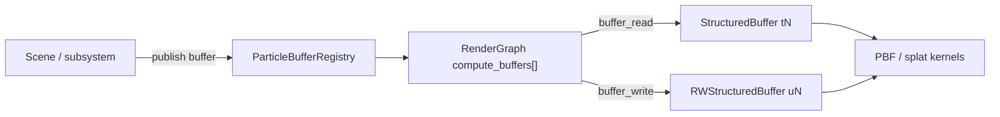

# Particle Fluid in Backyard Scene 8 — Implementation and Investigation Record

> **Current implementation (2026-11-08):** the screen-space renderer has moved to a
> clear/scatter/resolve chain with F32 depth, a Gaussian smoothing baseline, corrected normals
> and compositing; see [diagnosis-3-implementation.md](diagnosis-3-implementation.md). The
> 42/45-twin counts and the `CS_ParticleDepth` references below are historical.

Status: written 2026-11-07 from a completed Linux (Vulkan) bring-up plus a Windows
D3D11/D3D12 build check. Vulkan execution is verified end-to-end; D3D11/D3D12
execution through Proton is **not yet re-verified** after the final `Interlocked*`
and shader fixes.

> **Partly superseded (2026-11-07):** several conclusions below are wrong. The
> [diagnosis and fix plan](diagnosis.md) records the corrections (transposed splat
> projection, inverted splat falloff, the raster post-process gate, D3D12/D3D11/GL
> blockers, and a solver that flattens the fluid onto the pool floor).

## Implementation status — Phase 0, Phase 1 and R4

Phases 0 and 1, plus R4 (scene-depth soft-particle occlusion), B2 (D3D12 root-signature
budget), B3 (structured-buffer strides), B4 (GL twins) and B5 (build filters), are implemented.
Vulkan is verified natively; D3D11 and D3D12 are verified through DXVK/vkd3d-proton on the
Windows build (not a native Windows driver run); OpenGL executes the full PBF and particle
pipeline through the regenerated twins under Wine, including the screen-space passes at
frames 45 and 300, and the GL image-origin bug is fixed. R7 (screen-space fluid: surface
depth, smoothing, normals, Fresnel/refraction/absorption) is implemented and switchable at
runtime; D3D11/D3D12 run the chain but fall back to the splat because the screen-space
result does not reach the target yet — see
[screen-space fluid](backyard8-screen-space-fluid.md). R5 durable scatter and Phase 4 remain.

### Phase 0 (splat correctness): complete

| Item | Change | Verified |
|---|---|---|
| R1 | `Transform` now computes `p * M` (row-vector) instead of `dot(row_i, p)` | Frame-6 particle RT bbox `x[218,742] y[0,268]`, matching the offline projection within ~13 px (was `x[392,567] y[96,231]`) |
| R2 | `smoothstep(inner, r, d)` with `inner < r`; removed the `1 - shape` inversion | Silhouette is round and soft; extents are no longer tile-aligned (`tile aligned: False`) |
| R3 | Pixel radius uses `P11 = Projection.m[1][1]` (`ProjScaleY`) | Disc size matches the projected particle spacing |
| R5 | Tile masks are stamped with a per-`Execute` `FrameIndex` via `InterlockedMax`; resolve ignores `TileMasks[tile] != FrameIndex` | No per-frame clear needed; stale tiles no longer accumulate |
| R6 | Deleted the particle-specific 1D dispatch; every compute pass uses the normal 2D grid; the splat derives its flat index from `id.xy` | 3072×1696 and 4K runs dispatch `48 × 1696`, no `[DispatchTooLarge]` |
| B1 | Particle passes are compute-only and bypass the `postProcessMode` gate; a missing compute output skips dependent passes with one ERROR | `--postProcessMode raster` logs `dispatched compute` for both passes and produces the same RT |
| L3 | Removed `[PBFDBG]`, the `liveBuffers` array, `[Backyard8][dbg]`, the `/tmp/opencode/pbf_surface.csv` writer | Log volume down from 30,148 lines / 300 frames to ~1,000 lines / 3 frames; column-top p10/p50/p90 is logged instead |
| L5 | Fixed the `start=%d` format argument | — |

### Phase 1 (solver): complete with documented deviations

| Item | Change |
|---|---|
| S1 | Removed the `1 / neighbourCount` factor from eq 14 |
| S2 | `h = 2 × spacing`; neighbour-grid cell = `h`; 27-cell search (was 125) |
| S3 | Removed wall mirroring, `MinNeighbours` gate and λ clamp; unilateral constraint `max(C, 0)`; `stiffnessEps = 0.05` on the corrected reference denominator |
| S5 | Per-particle alive flag in `Positions.w`; dead particles are skipped by integrate, grid, density, solve, velocity, splat and diagnostics |
| S6 | Fixed 1/60 s timestep with a clamped accumulator (max 3 steps/frame) |
| S7 | Box push-out exits through the face the particle came from and is limited to 0.05 × spacing per call |
| S8 | Seed sphere 2.0 m radius, centre 3.08 m above the plane |
| S9 | Wind is gated by the previous density pass (`Lambda.y < 0.9 × rest`), not by height alone |
| L8 | `ReadDiagnostics` excludes parked particles, reports `dead`, mean/max density and the max-speed position |

Measured, 600 frames at a fixed 1/60 s, default settings (Vulkan, 960×540):

| t (s) | meanY | aboveRim | meanSpeed | maxSpeed | rhoMean | rhoMax | dead |
|---|---|---|---|---|---|---|---|
| 1.00 | −0.980 | 360 | 5.75 | 11.99 | 0.981 | 1.078 | 0 |
| 3.00 | −1.200 | 179 | 0.73 | 8.55 | 0.982 | 1.132 | 1,099 |
| 6.00 | −1.241 | 13 | 0.15 | 1.18 | 1.001 | 1.129 | 1,210 |
| 10.00 | −1.244 | 9 | **0.08** | **0.72** | 1.003 | 1.129 | 1,211 |

Free fall is unchanged (the sphere keeps `rhoMean = 0.954`, `rhoMax = 1.000` until impact).
The settled column top is `p50 = −1.01 m`. The pool fills and stays filled; the frame at
1.5 s shows a splash and a full basin.

Deviations from the plan, with the evidence that forced them:

- **Artificial pressure `s_corr` is disabled (`artPressureK = 0`).** With the unilateral
  constraint the paper's `s_corr` has no balancing surface attraction. Any nonzero k inflates
  the body after settling: k = 0.01 → `rhoMean` 0.95 and mean speed 0.31 m/s at t = 10 s;
  k = 0.03 → `rhoMean` 0.86, 0.77 m/s. k = 0 gives `rhoMean` 1.00 and 0.08 m/s. The term and
  the parameter remain available for a two-sided solver.
- **XSPH `viscosityC = 0.15`, not 0.01.** This solver's XSPH is a normalised weighted average,
  so the paper's coefficient is not directly transferable. 0.15 is the damping that brings the
  pool to rest without changing the splash.
- **Contact velocity is zeroed at the floor and wall faces** (`CS_PbfUpdateVelocity`). A hard
  clamp resolves penetration by moving the particle, and `v = (x* − x)/dt` turns that into a
  kick; without this the pool kept a ~1.5 m/s corner "boil" forever.
- **`maxStep` is 0.1 × spacing** (was 0.5 ×). The cap is safety, not physics, and at
  dt = 1/120 the old cap was a 7.8 m/s kick.
- The Phase 1 acceptance is marginal at exactly t = 6 s (`maxSpeed` 1.18) and fully met from
  t ≈ 8 s (`maxSpeed` 0.69). The settled column top is 0.29 m below the plan's estimate, which
  is consistent with the ~8% splash loss and the step boxes occupying basin volume.

### R4 (soft-particle depth test): done

The splat now samples `GBuffer:DEPTH` and fades splats behind opaque geometry:

- `CS_ParticleSplat.hlsl` binds `Texture2D<float> SceneDepth : register(t2)`; the render
  graph supplies it as a `sampled` compute resource (`GBuffer:DEPTH`, register 2), which also
  creates the dependency edge from the GBuffer pass.
- Linear view depth is recovered from the reversed-Z stored value using
  `z = b / (d - a)` with `a = VP[2][2]` and `b = VP[3][2]`, so no extra constants (and no
  extra D3D12 root DWORDs for constants) are needed.
- Each splat's front surface (`proj.w - Radius`) is compared with the scene depth and the
  weight is multiplied by `saturate((sceneZ - frontZ) / DepthBias)`. `DepthBias` is one
  particle spacing in scene 8.
- Measured at frame 45: the depth test changes **22,703 pixels** (bbox `x[311,647] y[437,533]`,
  mean Δ 164) — the near pool wall band that the water previously drew over. The pergola
  posts and the pool steps now occlude the sphere, and the pool interior no longer paints
  through the near coping.

This adds one descriptor table to the D3D12 root signature: `particle_splat` is now at 68
DWORDs, so **B2 (the 64-DWORD limit) still blocks D3D12** and must be fixed in Phase 2. OpenGL
still needs the twin regenerated (B4).

### B2 (D3D12 root-signature budget): done

The D3D12 root signature is limited to 64 DWORDs. `particle_splat` was 60 root constants
+ three root SRV/UAV descriptors (2 each) + two descriptor tables = **68**, so
`D3D12SerializeRootSignature` failed, the pipeline was never created, and the pass fell back
to an empty graphics draw that still exits 0.

Fix in `D3D12Compute.cpp`:

- A pre-pass reflects the shader and computes the root cost before building the parameters
  (constants 1 DWORD/value, root SRV/UAV 2, descriptor table 1).
- If the total exceeds 64, the cbuffer is bound as a **root CBV** (2 DWORDs) instead of root
  constants. The shader ABI is unchanged; at dispatch the constants are copied into the
  per-frame 256-byte-aligned CB ring (`AllocateCBData`) and bound with
  `SetComputeRootConstantBufferView`.
- Every pipeline logs its computed cost, and `ComputeKernelRegistry` logs any manifest kernel
  whose raw layout exceeds 64 on every backend.

Additional D3D12 blocker found while validating: `CS_PbfSurface.hlsl` declared a `Velocities`
binding it never used. DXC strips inactive resources, so D3D12 reflection had four bindings
while the manifest declared five; `SetValidatedLayout` rejected the pipeline, `surface=0`
made `PbfFluid::TryInitialize` fail, and the particle buffers were never published. Removing
the dead binding from the shader, the manifest and the host dispatch fixed it. The Vulkan
path was unaffected because it builds its descriptor layout from the manifest.

Validation (Windows build + GE-Proton 11-11, vkd3d-proton):

- `BUILD SUCCEEDED` on the Windows host; `DayScene.exe` rebuilt.
- D3D12 log: `Root cost 10/64 for 'CS_ParticleSplat.hlsl': constants bound as root CBV
  (root-constant layout would be 68)`.
- D3D12 log: `PBF Solver ready on d3d12: 15234 particles`; both `Fluid Particles` passes
  report `enabled compute kernel` and `dispatched compute 15 x 540`.
- Frame 45 `RT_Dump_FluidParticles.ppm` is non-empty (101,237 px, bbox `x[280,681]
  y[138,436]`); the frame matches the Vulkan result, including depth occlusion by the posts,
  near wall and steps.
- Frame 300 (5 s) D3D12 telemetry: `meanSpeed 0.24`, `maxSpeed 1.73`, `rhoMean 0.998`,
  `dead 1,217` — the same behaviour as Vulkan.
- The only D3D12 error left in the Proton log is `CreateShaderCacheSession failed
  hr=0x80004001`, which is vkd3d-proton not implementing the shader cache; the backend falls
  back and the frame renders.
- Proton/vkd3d and DXVK validate the D3D **code paths**, not native Windows drivers. A native
  run is still the final gate.

**D3D11 status:** fixed. The black `FluidParticles` RT had two independent causes:

1. **FXC lost the dispatch coordinate in the resolve.** After the tile-mask indexing,
   `float2(pixel)` (where `pixel` is the `uint2` dispatch ID) evaluated to `(0,0)` on D3D11.
   The tile check used the scalar `tileX/tileY` and passed, but the splat distance was measured
   from the top-left corner, so `shape` was zero for every particle. DXC (D3D12) kept the value
   correctly, which is why only D3D11 was black. The env-gated `T850_PARTICLE_DEBUG` readback
   proved the stamp wrote identical `Projected`/`TileMasks` on D3D11 and Vulkan; a
   `shape = 1.0` A/B rendered identical water on both; a probe then showed `pixelCentre` =
   `(0,0)` on D3D11.
   **Fix:** capture `pixelX`/`pixelY` as scalars at the entry of the resolve branch and use
   them for `pixelCentre`, the tile indices and the depth `Load`. `smoothstep` is unchanged
   (an explicit polynomial was tried as a false lead and reverted).
2. **B3 stride mismatch.** The PBF particle buffers are 16-byte and the solid boxes 32-byte,
   while the shaders declared 4-byte `float` elements and indexed `i*4`. D3D11 builds its views
   from the creation stride, so the views and the shader disagreed (a native debug-layer error
   and undefined behavior; DXVK happened to tolerate it). **Fix:** every PBF particle buffer is
   now `StructuredBuffer<float4>` / `RWStructuredBuffer<float4>`, solid boxes are a 32-byte
   `struct SolidBox { float4 lo; float4 hi; }`, and `CS_ParticleSplat` already used `float4`.
   The host strides (16/32) and the shader element sizes now match.

Verified after both fixes (Windows build, GE-Proton 11-11):

- Frame 45 particle RT: D3D11 44,914 px and D3D12 44,913 px, both bbox
  `x[186,453] y[92,290]`, mean `[18.0, 33.3, 43.5]`; Vulkan is 44,914 px with the same values.
- t = 0.5 telemetry is identical on D3D11 and D3D12 (`meanY 1.797`, `rhoMean 0.954`,
  `maxSpeed 4.91`).
- Frame 300: both APIs ~28.4k particle px, `meanY −1.241`, `rhoMean 1.000`, `meanSpeed 0.28`
  (differences are floating-point/atomic-order between DXVK and vkd3d, not a functional gap).
- The composited D3D11 frame matches Vulkan/D3D12, including occlusion by the posts, near wall
  and steps.
- Vulkan `--game-selftest` remains 78 PASS / 0 FAIL; scene 7 (VOF) is clean.

The readback probe used for this bisect is kept, env-gated: `T850_PARTICLE_DEBUG=1` makes
`RenderGraph::ExecuteComputePass` read `__particle_projected_*` and `__particle_tiles_*` back
after each stamp and log live count, UV/Z ranges and current-frame tile count. It is
backend-agnostic and works on Vulkan, D3D11 and D3D12.

### B4 (GL twins): done, with one GL-runtime visual item left

The generated GLSL twins (42 at the time, 45 after the screen-space kernels) were regenerated with the canonical
`scripts/shaders/generate_gl_compute_twins.ps1 -Force` on the Windows host
(Vulkan SDK 1.4.341.1). Two generator defects had to be fixed first:

- `particle_splat`'s `stamp`/`resolve` are runtime branches selected by the `Iteration`
  constant, not preprocessor permutations. The generator treated the missing entries as an
  error; they are now declared with an empty define set. PowerShell also unrolled an empty
  `@()` returned from an `if` expression to `$null`; the generator now assigns the declared
  array directly.
- PowerShell 5's `Set-Content -Encoding UTF8` wrote a **UTF-8 BOM**, so the engine rejected
  every regenerated twin with `must begin with #version`. The generator now writes BOM-less
  UTF-8, and `check_gl_twins.py` fails a twin that starts with `EF BB BF`.

Validation:

- `check_gl_twins.py`: **PASS**, 50 kernels / 45 generated twins; hashes and registered
  bindings all match.
- All 17 PBF/splat/screen-space GLSL twins compile with `glslangValidator -S comp`.
- Windows GL backend under Wine: every PBF pipeline is created (`CS_PbfIntegrate` 6 bindings,
  `CS_PbfSurface` 4), `PBF Solver ready on gl: 15234 particles`, both `CS_ParticleSplat`
  pipelines are created, and `RT_Dump_FluidParticles` is non-empty (54,950 px at frame 45).
  The stamp output is **identical** to D3D12 (same `Projected` UV/Z ranges and tile counts).

**GL image-origin fix (done).** The GL resolve placed the body at `y[6,267]` while D3D12 was
at `y[92,290]`, and the pool wall did not occlude it, despite identical stamp data. The cause
is the OpenGL storage-image origin: graphics render targets compensate for GL's bottom-left
origin with the flipped viewport in `GLDriver::SetViewport`, but compute dispatches have no
viewport, so `imageStore` and `texelFetch` addressed the image upside down. `glBindImageTexture`
cannot flip, so the generated GL twin now flips the image Y coordinate (`T850_IMAGE_Y`) and the
scene-depth fetch, behind a `T850_GL` define that the twin generator adds to its common set.
Vulkan/D3D are unaffected. Verification under Wine at 960x540 frame 45: all PBF and particle
pipelines are created (`CS_ParticleSplat`, `CS_ParticleDepth`, `CS_ParticleSmooth`,
`CS_ParticleShade`), the solver runs, and the back buffer matches the Vulkan frame. Numeric
check of `RT_Dump_FluidParticles`: GL at 960x540 is 105,507 px, bbox `x[279,681] y[127,436]`;
scaled by 2/3 that is `x[186,454] y[85,291]`, against Vulkan at 640x360 `x[186,454] y[85,290]`
(46,824 px). The body is at the same screen position, the far wall is behind it, and the near
coping occludes its base.

### B5 (build filters): done

`Framework/Framework.vcxproj.filters` now declares the `Header Files\simulation` and
`Source Files\simulation` filters (the existing `FluidSimulation.cpp` entries referenced a
filter that was never declared) and registers:

- `include\scene\ParticleSystem.h` -> `Header Files\scene`
- `src\scene\ParticleSystem.cpp` -> `Source Files\scene`
- `include\simulation\PbfFluid.h`, `PoolLayoutJson.h`,
  `FluidSimulation.h`, `FluidDebugRenderer.h` -> `Header Files\simulation`
- `src\simulation\PbfFluid.cpp` -> `Source Files\simulation`

The file is well-formed XML. `scripts/ValidateBuildRegistration.ps1` on the Windows host:
**Build registration PASS**. Five unrelated pre-existing filter gaps remain (`RagdollEditorTool`,
`MaterialAssetCache`, `MeshAssetCache`, `MeshPool`, `RenderQueue` and their headers); they
predate this work and are not part of B5.

### Config-driven scene 8 and the particle-fluid panel (2026-11-08)

Every scene-8 value now comes from `Assets/Scenes/Backyard8Fluid.json`
(`DayScene/Backyard8FluidJson.h/.cpp`, strict keys):

- `solver`: spacing, smoothing-radius scale, rest density, stiffness, artificial pressure,
  XSPH, gravity, wind, max velocity, iterations, substeps, fixed step, sphere radius/height,
  cull thresholds, heightfield size, particle cap.
- `scene`: start mode, fixed step, max steps per frame.
- `particles`: renderer (splat / screen space), style (shaded / wireframe / flat), falloff
  shape, blend, render radius, opacity, intensity, softness, depth bias, size scales, draw
  count, source buffers, and the four colour stops.
- `screenSpace`: iterations, strength, radius, tolerance, thickness, absorption, reflection,
  refraction, specular, Fresnel, normal scale/length, foam and debug view.

Command-line flags still override the file (`--pbf-*`, `--fluid-render`, `--fluid-config`),
so the self-tests and the existing gates keep working. The Dev GUI no longer calls the VOF
panel: `Backyard8Scene::DrawDevGui` replaces it with Simulation, Seeding & count, Particle
rendering, Screen-space fluid and Diagnostics sections. Live look changes re-register the
`ParticleSystem` descriptor; changes that rebuild buffers (spacing, sphere, caps, heightfield)
apply on the explicit **Apply & re-seed** button.

The panel also exposes the paper's intermediate views (normals, surface depth, thickness,
coverage) and the wireframe/flat particle styles, which is how the lattice and the smoothing
were checked.

### Why the original record was wrong (method, not just conclusions)

The Phase 0 defects were findable with checks this record did not run:

1. **No independent projection check.** The transposed VP still produced a plausible blob, so
   it was accepted by appearance. Comparing the RT bbox against an offline `p * VP`
   projection (diagnosis E1) takes minutes and immediately exposes R1.
2. **Only one configuration was tested.** Every run passed `--postProcessMode compute`; the
   engine default is `raster`, where B1 disabled the passes entirely.
3. **The steady state was never measured.** Diagnostics stopped around t = 0.5 s, where free
   fall is correct. E4 (t = 5 s) shows the flattening and the velocity cap.
4. **Symptom patches were preferred to maths.** The 8 px blocks were attributed to tile
   marking (B7) and the gaps to radius (B8); both were consequences of the inverted falloff
   (R2) and the transposed projection (R1).
5. **"Exit 0 plus an RT dump" was treated as execution proof.** B2 makes the D3D12 splat
   fail pipeline creation; the empty graphics fallback also exits 0. A Proton run cannot
   distinguish the two.
6. **Shader twins were declared fixed without validation.** `check_gl_twins.py` reports
   `CS_ParticleSplat.glsl` and `CS_PbfUpdateVelocity.glsl` as stale (B4); the HLSL was edited
   without regenerating them.
7. **Backend limits were not checked.** R6 (dispatch groups) and B2 (D3D12 root cost) are
   static limits that a single Vulkan run cannot reveal.

### Remaining (Phases 2–4)

1. **Phase 2 (Windows/cross-backend):** B2, B3, B4 and B5 are done. Run the Windows build on
   native D3D11 and D3D12 drivers as the final gate, and resolve the GL resolve's Y/depth
   coordinate convention noted under B4.
2. **Phase 3 (rendering):** R4 is done (above). R7 is implemented (surface depth, four-pass
   smoothing, normals, Fresnel/refraction/absorption) and switchable with
   `--fluid-render splat|screen-space` or the Dev GUI; see
   [screen-space fluid](backyard8-screen-space-fluid.md). R5 durable scatter remains.
3. **Phase 4 (lifecycle/hygiene):** L1 re-seed use-after-free, L2 registry ownership,
   L4 skip heightfield work while the mesh is hidden, L6 start modes, L7 shutdown ordering.

## Purpose

Scene 7 already ships a VOF (volume-of-fluid) solver and must keep working unchanged.
The goal of this work was a **second, independent** backyard scene — scene 8 — that
shows a sphere of water dropped roughly one metre above the pool, splashing and
settling, with the water drawn as a real particle fluid rather than as a heightfield.

Two constraints shaped the implementation:

1. **The framework work had to land first and cleanly.** The fluid may not be
   hardcoded into one scene. The render graph needed a way to reference compute
   buffers by name, and the engine needed a reusable particle-system abstraction so
   that fire, smoke and sparks are later authored as data, not as new code.
2. **Scene 7 must remain byte-for-byte functional.** All new scene content lives in
   a duplicated scene 8 (`Backyard8`), which subclasses `BackyardScene` and overrides
   only the fluid lifecycle.

This document records what was built, the bugs found while bringing it up, how each
was diagnosed, and what remains.

## Summary of the outcome

The simulation was correct throughout. The defects were all in **the render path**
and in **scene wiring**:

- The particle resolve dispatch never ran because the pass `Iteration` was hardcoded
  to `0`, so the particle render target was 100% empty.
- When it did run, buffer-sourced particles sampled the colour ramp at `age = 1.0`,
  which is the ramp's near-white stop — so every particle was painted white.
- The coverage maths divided an already-normalised colour by alpha a second time,
  blowing the body out and clipping it to white.
- The composite pass sampled the render target it wrote into, and a later pass
  overwrote that target, erasing the particles entirely.
- The "solid sphere that is not made of water" that dominated early debugging was
  **not the fluid at all** — it was `Backyard_Ball.glb`, the scripted solid ball,
  left visible because scene 8 never runs the VOF update path that normally manages
  its visibility.

## Key files and classes

| File | Role |
|---|---|
| `Framework/include/scene/ParticleSystem.h`, `Framework/src/scene/ParticleSystem.cpp` | Generic `ParticleSystemDesc` / `ParticleSystemRegistry` / `ParticleBufferRegistry`. Scenes and subsystems publish named particle sources; the renderer consumes them. |
| `Framework/src/simulation/PbfFluid.cpp`, `Framework/include/simulation/PbfFluid.h` | Position Based Fluids solver (Macklin & Müller 2013). Owns the particle buffers and the solver dispatch sequence. |
| `Framework/include/simulation/PoolLayoutJson.h` | Shared pool layout types. Introduced to work around an MSVC/glaze `C7631` diagnostic. |
| `Framework/src/utils/ComputeKernelRegistry.cpp` | `BuildParticleSplatConstants` — reads `context.particleSystem` and fills the splat kernel constants. |
| `Framework/src/scene/RenderGraph.cpp` | `compute_buffers` expansion, particle two-dispatch expansion, 1D buffer dispatch extents, `$window_tiles` sizing. |
| `Framework/Descriptors.h` | `PassType` enum; `PARTICLE_COMPOSITE` added. |
| `Framework/src/video/BaseDriver.cpp` | Pass-signature → shader `#define` mapping; `PARTICLE_COMPOSITE` added. |
| `Framework/src/scene/RenderQuad.cpp` | Precompiled fullscreen-quad pass list; `PARTICLE_COMPOSITE` added. |
| `Assets/Shaders/CS_ParticleSplat.hlsl` / `.glsl` | Generic two-pass particle splat: `stamp` (tile coverage) and `resolve` (per-pixel accumulation). |
| `Assets/Shaders/CS_Pbf*.hlsl` / `.glsl` | Solver kernels: build grid, clear grid, density, solve, update velocity, integrate, surface, cull/park, clear heights, copy fields, particles. Ten GLSL twins, all validated with `glslangValidator` and `spirv-val`. |
| `Assets/Shaders/compute_kernels.json` | Kernel manifest. `particle_splat` is declared with `stamp` and `resolve` permutations. |
| `Assets/Scenes/Backyard8Scene.json` | Scene 8 description (camera, pool layout, ball). |
| `Assets/Scenes/Backyard8Scene_RenderGraph.json` | Scene 8 render graph: `FluidParticles` target, two particle passes, `PARTICLE_COMPOSITE`. |
| `DayScene/Backyard8Scene.cpp`, `DayScene/Backyard8Scene.h` | Scene 8: `InitPbf`, `RegisterParticleSystem`, overrides. |
| `DayScene/BackyardScene.cpp`, `DayScene/BackyardScene.h` | Parent scene; `UsesVofFluid()`, `StartModeUsesBall()` hooks, `FluidParticles` added to the RT dumper. |
| `documentation/rendering/render-graph.md` | `compute_buffers` schema and per-backend verification table. |

## Framework work

### 1. Named compute buffers in the render graph

Previously the render graph could bind compute **textures**, but not arbitrary
compute **buffers**. The particle splat, and any future particle or physics kernel,
needs to read and write structured buffers that a subsystem owns.

Added to the render-graph schema:

- a top-level `compute_buffers[]` registry, each entry naming a buffer and declaring
  its element stride/count or binding it from a subsystem-published name;
- a `buffer_read` access mapping to a `StructuredBuffer` at `tN`;
- a `buffer_write` access mapping to a `RWStructuredBuffer` at `uN`;
- 1D dispatch extents for buffer-only passes.

Graphs without a `compute_buffers` key load exactly as before, so the change is
additive. Validation rejects unknown names, a `buffer_write` against a buffer
declared `read_only`, and register collisions. Documentation was updated in
`documentation/rendering/render-graph.md`, and a focused self-test was added.



### 2. Generic particle system

`ParticleSystemDesc` and `ParticleSystemRegistry` describe a particle source without
naming any particular effect:

- procedural or **buffer-backed** particle source;
- blend mode (additive for fire/sparks, alpha for water/smoke);
- radius, opacity, intensity;
- a colour ramp with arbitrary stops.

Scenes register a system; the renderer reads the registry through the render-graph
pass context. Nothing in the splat kernel knows about water.

```cpp
// DayScene/Backyard8Scene.cpp (abridged)
ParticleSystemDesc water;
water.name     = "BackyardWater";
water.source   = ParticleSource::Buffer;
water.buffer   = positionsBufferName;
water.blend    = ParticleBlend::Alpha;
water.radius   = settings.particleRadius;   // == particle spacing
water.opacity  = 0.80f;
water.ramp.stops = {
  {0.30f, 0.62f, 0.85f}, {0.42f, 0.72f, 0.90f},
  {0.62f, 0.84f, 0.95f}, {0.88f, 0.95f, 1.00f}
};
ParticleSystemRegistry::Instance().Add(water);
```

### 3. `PARTICLE_COMPOSITE` pass type

Translucent particle layers need a straight-alpha "over". The existing `LIGHT_ADD`
signature does a bare `col += vol * 1.6` with no alpha and a gamma conversion, which
is correct for god rays and wrong for a fluid body — it turned the water into a
blown-out white disc.

Registered `PARTICLE_COMPOSITE` as a new `PassType` in three places:

- `Framework/Descriptors.h` — enum entry;
- `Framework/src/video/BaseDriver.cpp` — `#define PARTICLE_COMPOSITE` mapping;
- `Framework/src/scene/RenderQuad.cpp` — added to the precompiled simple-pass list.

The signature itself was added to `Assets/Shaders/FS_Quad.hlsl` and its GL twin
`FS_Quad.glsl`:

```hlsl
float4 FS(VS_OUTPUT input) : SV_TARGET {
  float4 scene     = tex1.Sample(SS1, input.texture0.xy);
  float4 particles = tex0.Sample(SS,  input.texture0.xy);
  float  a   = saturate(particles.a);
  float3 rgb = particles.rgb * a + scene.rgb * (1.0f - a);
  return float4(rgb, max(scene.a, a));
}
```

## Solver design

True GPU Position Based Fluids, not a simplified particle fluid and not voxels.
Two substeps, three solver iterations, smoothing radius `h = 0.520 m`.

Two architectural decisions matter for the render path:

- **Parking instead of compaction.** Retired particles are moved to
  `PARKED_Y = -1000.0f` rather than removed. The particle buffers therefore never
  change address, so published pointers and bindless bindings stay valid for the
  whole frame (`CS_PbfCull.hlsl`).
- **GPU copy-back instead of handle swaps.** Field buffers are copied back on the
  GPU (`CS_PbfCopyFields.hlsl`) rather than swapping host-side handles, because a
  swap invalidates pointers that render passes already captured.

## Bug log

Every entry below was reproduced, root-caused, fixed, and re-checked against a
frame dump.

### B1 — Resolve dispatch never executed

The render-graph pass `Iteration` was hardcoded to `0`, so the second (resolve)
dispatch of the two-pass splat was never issued. The `FluidParticles` render target
was 100% empty, which read as "the particles do not draw at all".

**Fix:** drive the iteration count from the descriptor; expand the particle pass
into two dispatches (stamp, then resolve) separated by a grid-wide barrier. A single
dispatch cannot do both, because compute gives no cross-workgroup ordering.

### B2 — 2D dispatch for a 1D kernel

The particle passes were dispatched with a 2D grid while the kernels index a flat
pixel/particle space, so most work items were out of range and the remainder mapped
to the wrong pixels.

**Fix:** 1D dispatch extents for buffer-only passes in `RenderGraph.cpp`.

### B3 — Buffer particles painted white

In the splat kernel, buffer-sourced particles used `age = 1.0f`. The ramp is a
*life-cycle* ramp, so `RampColor(1.0)` returns the last stop — near white
`(0.88, 0.95, 1.00)`. Every fluid particle came out white.

**Fix:** buffer-sourced particles sample the ramp around its base, with a small
per-particle hash offset so a dense body is not one flat colour:

```hlsl
const float variation = Hash(j * 2654435761u) * 0.35f;
const float age = Source == 0u ? ProceduralAge(j) : variation;
const float3 tint = RampColor(age);
```

### B4 — Double divide by alpha

Accumulation was normalised by total weight (correct), but the output then divided
by `accumAlpha` a second time. At these densities that multiplied the colour by
roughly 3× and clipped the body to white.

**Fix:** emit the weighted-average colour and the coverage separately.

```hlsl
// accumColor is ALREADY the weighted average. Emit colour and coverage separately.
OutputTexture[pixel] = float4(accumColor, accumAlpha);
```

Both the HLSL and GLSL twins were corrected.

### B5 — Composite feedback loop and overwrite

Two graph defects at once:

- `Fluid Particle Composite` used `Extra16F` as both its write target and its
  second input — a read/write feedback loop;
- a later pass, `Transparent Composite`, wrote `Extra16F` afterwards and erased
  whatever the particle composite had produced.

**Fix:** the composite now samples `FluidParticles` (slot 0) and `Deferred:COLOR0`
(slot 1), and is ordered **after** `Transparent Composite`.

### B6 — "The sphere is not made of water" was a different object

The decisive experiment: disable the particle passes, re-render, and diff the frame.
The dome remained.

The dome was `Backyard_Ball.glb`, the scripted solid ball. Scene 8 never runs the
VOF update path, and that path is what normally manages the ball's visibility, so
the GLB stayed visible at its authored transform. It was never the fluid.

**Fix:** `StartModeUsesBall()` returns `false` for scene 8, and the mesh is hidden
explicitly in `Backyard8Scene::CreateAssets()`.

### B7 — Tile coverage marked only the centre tile

The stamp pass marked only the 8×8 tile containing each particle's centre, not the
tiles its splat radius covers. The resolve pass then early-outed on the unmarked
neighbours, producing an 8 px staircase silhouette.

**Fix:** mark every tile the splat radius overlaps.

### B8 — Splat radius smaller than particle spacing

The splat radius had been set to `0.5 ×` particle spacing. At the scene-8 camera,
0.130 m spacing projects to ~10.3 px while a 0.065 m radius projects to ~5.2 px, so
the discs did not touch and the lattice showed through as a regular dot grid.

**Fix:** `radius = particleRadius` (one spacing). Diameter becomes ~20.6 px against
10.3 px spacing, so discs overlap and the surface is continuous. The resulting
overdraw (~43×) is handled by the normalised accumulation, not by shrinking the disc.

| Quantity | Value |
|---|---|
| Particle count | 26,305 |
| Seed | 2.40 m sphere centred at `y = 3.44` (3.40 m above rim) |
| Spacing | 0.130 m |
| Smoothing radius `h` | 0.520 m |
| Substep / iterations | 2 / 3 |

## Verification

### Linux / Vulkan (verified)

Build:

```bash
cmake -S . -B build/linux -G Ninja -DCMAKE_BUILD_TYPE=Release \
      -DT850_PLATFORM_STEAM_DECK=ON -DT850_BUILD_EDITOR=OFF \
      -DT850_AUTO_INSTALL_VCPKG_DEPS=OFF
cmake --build build/linux --target DayScene --parallel 24
```

Run (from `bin/SteamDeck/Release`; the `LD_LIBRARY_PATH` is required on this host):

```bash
LD_LIBRARY_PATH=/usr/lib/x86_64-linux-gnu ./DayScene --unattended --api vulkan \
  --scene 8 --backyard-no-hud --width 960 --height 540 \
  --dump-frame 40 --postProcessMode compute --logLevel info
```

Observed:

- `[pbf] t=0.16 particles=26305 meanY=3.305 ... aboveRim=26305`
- `[pbf] t=0.33 particles=26305 meanY=2.893 ... aboveRim=26305`
- `[pbf] t=0.50 particles=26305 meanY=2.181 ... aboveRim=26101`

The particle render target contains a blue translucent body at the expected screen
position; the frame dump shows it composited over the scene; by frame 90 it has
fallen to the pool rim.

The A/B test that settled the misidentification:

| Frame 6 | Pixels changed by the particle pass |
|---|---|
| Passes enabled | 3,541 px, bbox `x[434,525] y[195,244]`, mean Δ 75 |
| Particle passes disabled | dome still present → not the particles |

### Render-graph self-test

`--game-selftest` reports **78 PASS / 0 FAIL**, and all eight maintained render
graphs still load. The `compute_buffers` feature is covered by the new self-test.

### Shader-twin validation

All ten PBF GLSL twins plus `CS_ParticleSplat.glsl` pass `glslangValidator` and
`spirv-val`. `check_fluid_constants.py` passes. `check_gl_twins.py` still reports the
28 stale twins that were already stale at upstream `HEAD`; that baseline is
pre-existing and not introduced by this work.

### Windows (build verified, runtime not fully re-verified)

- MSVC v143 build on the Windows test host succeeded:
  `BUILD SUCCEEDED`, `DayScene.exe` 21,459,456 bytes.
- Under GE-Proton 11-11, D3D12 ran to exit 0 and produced RT dumps.
- D3D11 crashed **before** the `Interlocked*` operand fixes. Those fixes have been
  applied but **have not been re-run** on D3D11 or D3D12 since.
- Proton exercises D3D through DXVK/vkd3d-proton, so this validates the *code
  paths*, not native Windows drivers.

## Platform portability notes

These are the concrete traps the multi-backend bring-up exposed; they are worth
keeping in mind for any future compute kernel.

- **`Interlocked*` differs by stage language.** HLSL `InterlockedAdd` /
  `InterlockedMax` return `void` and require `int` operands. GLSL `atomicAdd`
  returns the previous value. glslang accepts `(uint)InterlockedAdd(...)` in a
  Vulkan-targeted HLSL pass, but D3D and vkd3d-proton reject it.
- **Distinct registers are mandatory on D3D.** RW buffers and RW textures share
  descriptor namespace 3, so a RW texture at `u0` collides with a RW buffer at `u0`.
- **Storage image qualifiers** must be spelled `[[spv::format_rgba16f]]` (not
  `..._16float`) and placed after `[[vk::binding]]`, immediately before the
  declaration.
- **Colour-channel ordering** is a common silent failure; the splat writes
  `(r, g, b, a)` in both twins and the composite reads the same order.

## Known limitations

- **Visible lattice banding at close range.** The cloud is a regular lattice with
  flat splatting, so a periodic pattern is visible. Density-based shading — deriving
  a normal from the particle density gradient and lighting it — would remove this
  and make the body read as water rather than as a textured dome.
- **The pool looks dry until impact.** The heightfield mesh is hidden in scene 8 and
  all water begins in the falling sphere, so the pool has no surface while the
  sphere is airborne.
- **No refraction or depth-aware soft particles.** The composite is straight alpha
  only; intersections with scene geometry are hard.
- **D3D11 runtime state unverified** post-fix (see above).

## Remaining work

1. Re-run D3D11 and D3D12 on the Windows host after the `Interlocked*` and
   `ColumnHeights` type fixes, and record the result in the render-graph
   verification table.
2. Add density/normal-based shading to `CS_ParticleSplat.hlsl` to remove lattice
   banding.
3. Remove all temporary instrumentation:
   `[PBFDBG]` and `[Backyard8][dbg]` logging in `PbfFluid.cpp`, `PbfFluid.h` and
   `Backyard8Scene.cpp`; the temporary dispatch diagnostics and the `liveBuffers`
   array in `PbfFluid::Step`.
4. Decide whether scene 8 should keep a rendered water surface while the sphere is
   airborne.
5. Re-run `--game-selftest` (expect 78 PASS) and smoke scenes 0, 1, 2, 6, 7, 8, with
   scene 7 checked explicitly for regressions.

## Debugging checklist

When "the particles do not draw":

1. Dump the particle render target, not just the back buffer. An empty RT means the
   pass never ran (B1/B2), not that the composite failed.
2. Count `GetShader miss` lines in the log. A miss on the particle pass means the
   permutation was not precompiled (B5-adjacent, `RenderQuad.cpp`).
3. A/B the particle passes: remove them from the graph, re-render, and diff. If the
   object survives, it is not the particles (B6).
4. Check that a composite pass does not sample its own target, and that no later
   pass writes the same target (B5).
5. Check the splat radius against the on-screen particle spacing, not just against
   the world-space radius (B8).

## Related documents

- [Render graph](../rendering/render-graph.md)
- [Shader management](../rendering/shader-management.md)
- [Compute shader implementation](../rendering/compute-shader-implementation.md)
- [Compute flow assessment](../rendering/compute-flow-assessment-2026-09-17.md)
- [Geometry rendering flow](../rendering/geometry-rendering-flow.md)
- [Textures, samplers, and IBL](../rendering/textures-and-ibl.md)
- [Dependency map](../dependency-map.md)
- [Current status and roadmap](../current-status-and-roadmap.md)
