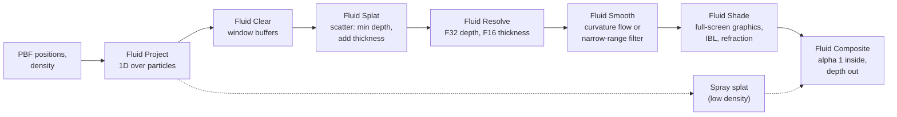
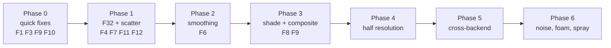

# Backyard Scene 8: Diagnosis 3 — SSFR Review and Implementation Guide

> **Implementation status (2026-11-08):** Phases 0–2 and the compositing part of Phase 3 are
> implemented and verified on Vulkan, D3D12 and GL; see
> [diagnosis-3-implementation.md](diagnosis-3-implementation.md). The shipped smoothing is a
> 24 px separable Gaussian baseline, not the exact curvature-flow PDE; half resolution,
> IBL shading, foam and spray remain.
>
> **Solver follow-up (2026-11-08, same file):** the "water glued to the pool walls" artefact
> reported after the renderer work was a solver boundary defect, not SSFR. It is fixed with
> Akinci-style analytic boundary density/gradient (density, CFM denominator and pressure), a
> correct wall extent (`waterPlaneY + freeboard`, not the water line) and retirement of
> particles stranded below the rim. Measured before/after is in
> [diagnosis-3-implementation.md](diagnosis-3-implementation.md#solver--analytic-solid-boundary-the-water-glued-to-the-walls-fix).

Status: written 2026-11-08 against commit `6658d56` ("Backyard 8: screen-space fluid,
config-driven particle scene, GL fix"). Vulkan findings were reproduced natively on Linux
(NVIDIA RTX PRO 6000, `T850/bin/SteamDeck/Release/DayScene`, built from this commit). D3D11 and
D3D12 findings were reproduced with the 2026-11-08 02:06 Windows build under GE-Proton 11-11,
with shaders and scene JSON identical to the commit. Native Windows was not run. Shader probes
were run from scratch copies; the repository was not modified apart from this document, its
README row and the pointer in [diagnosis-2](diagnosis-2.md).

This is the sequel to [diagnosis.md](diagnosis.md) and [diagnosis-2.md](diagnosis-2.md). Where
they disagree with this document, this document is current
([section 8](#8-corrections-to-diagnosis-2)).

## 1. Purpose

Scene 8 renders its PBF particles with a screen-space fluid renderer (SSFR) after
van der Laan, Green and Sainz, *Screen Space Fluid Rendering with Curvature Flow* (I3D 2009).
The current chain shows lattice facets and wrong lighting on Vulkan and OpenGL, does not
show at all on D3D11, and costs about 7 ms per frame at 1080p on a top-end GPU.

This document records what is wrong (with evidence), then gives a complete implementation
guide for SSFR in this engine: the target pipeline, kernel sketches, the engine features it
needs, and a phased plan with measurable acceptance checks.

## 2. Summary

| Area | Finding | Evidence |
|---|---|---|
| D3D11, native | `CS_ParticleShade.hlsl` uses `Texture2D.Sample`, which FXC rejects in `cs_5_0` (error X4532). The shade pipeline cannot be created; only the splat underneath is visible. | E3 |
| D3D11, Proton | Proton's `d3dcompiler_47.dll` is Wine's builtin (vkd3d-shader HLSL compiler), not FXC. It accepts the kernels but miscompiles them: the depth pass rejects every particle, so the shade never writes. Proton runs say nothing about native D3D11. | E3 |
| D3D12 | Works. Under Proton (DXC + vkd3d-proton) the particle target matches Vulkan (mean difference 0.08 of 255). Diagnosis-2's "D3D12 falls back to splat" is out of date. | E2 |
| Normals | Two sign errors: the x component of the normal is mirrored, and the "smallest difference" rule picks `-dl`/`-du`, flipping the sign on half of every bump. On the falling sphere 77% of left-side normals point right. Fixed in a probe: 100% correct. | E4 |
| Depth precision | Surface depth is stored and smoothed in RGBA16F: 3.9 mm steps at 4–8 m, 7.8 mm at 8–16 m. That is the same size as the per-pixel depth change of a smooth surface, so normals terrace. The engine cannot create an R32F storage target today (format-name mismatch). | E4, F4 |
| Surface definition | The depth pass keeps the **minimum** sphere front (diagnosis-2 says weighted average). With a lattice seed this is a faceted envelope; the four-pass radial average does not remove it. | E4 |
| Smoothing | The four-pass radial average is not curvature flow. Implementing the paper's equations literally with positive depth runs the flow backwards (it sharpens and diverges); the sign must be flipped. | E7 |
| Thickness | The chord sum over-counts by the sphere packing factor: 12.2 m measured where the true path is at most 4.0 m. Absorption is tuned around that. | E5 |
| Compositing | Shaded colour already contains the refracted background, but it is blended again with alpha 0.82, and the splat stays underneath as a "fallback". Refraction y offset is inverted; reflection is not an environment lookup. | F8, F9 |
| Scene depth | Occlusion linearises scene depth with view-projection terms instead of projection terms: 2.7% too near (0.19 m at 7 m, 0.27 m at 10 m). Same bug in the splat. | E6 |
| Performance | The depth pass and the splat resolve are both per-pixel loops over **all** particles. At 1080p: 15.0 ms per frame in screen-space mode versus 8.0 ms in splat mode; smoothing accounts for about 0.5 ms of the difference. | E8 |

What to do, in order: fix the two shader bugs that block D3D11 and lighting (Phase 0), then
replace the gather with a scatter into R32F (Phase 1), then add real smoothing (Phase 2),
shading and compositing per the paper (Phase 3), half resolution (Phase 4), cross-backend
verification (Phase 5) and noise, foam and spray (Phase 6). [Section 7](#7-implementation-plan)
has the acceptance checks.

## 3. Evidence

All Vulkan runs: source root `T850/`, from `bin/SteamDeck/Release`, 960x540, fixed 1/60 s,
compute post-processing, scene camera. Debug views come from `screenSpace.debugView` in a copy
of `Assets/Scenes/Backyard8Fluid.json` passed with `--fluid-config` (an absolute path works
on Linux):

```bash
export LD_LIBRARY_PATH=/usr/lib/x86_64-linux-gnu
./DayScene --unattended --api vulkan --scene 8 --backyard-no-hud --width 960 --height 540 \
  --regressionFixedDt 0.0166667 --postProcessMode compute --logLevel info \
  --fluid-config /tmp/cfg_dv1.json --dump-frame 24
# debugView: 0 shaded, 1 normals, 2 depth (z/12), 3 thickness, 4 coverage
```

Frame 24 is the best normal test: the sphere is intact and above the coping. Frame 45 is just
after impact; frame 300 is the settled pool.

### E1. Vulkan output today

- Frame 24/45: a teal sphere with bright octagonal rings. The normal view shows concentric
  octagonal terraces (the cubic seed lattice) and is mostly yellow and green, meaning normals
  that point up and to the right everywhere.
- Frame 300: a dark band in the particle target and a pale, almost invisible pool in the final
  image; stray particles on the deck render as spheres; particles stacked against the side
  walls render as slanted bands. (The wall stacking was fixed later the same day — see the
  implementation status note at the top and the solver boundary section of
  [diagnosis-3-implementation.md](diagnosis-3-implementation.md).)
- The splat resolve still runs underneath and shows as a light-blue rim at the silhouette.

### E2. D3D12 matches Vulkan

Frame 45, particle target `RT_Dump_FluidParticles`:

| Backend | Non-zero px | Mean RGB |
|---|---|---|
| Vulkan (native) | 105,619 | (50.3, 97.1, 123.9) |
| D3D12 (Proton: DXC, vkd3d-proton) | 105,618 | (50.3, 97.0, 123.7) |
| D3D11 (Proton: Wine `d3dcompiler_47`) | 105,619 | (92.2, 171.0, 223.0), the splat colour |

D3D12 versus Vulkan: mean absolute difference 0.08 levels; 2,918 pixels differ by more than 2
(the sign noise from E4).

### E3. D3D11: two independent failures

**Native Windows.** `D3D11ComputePipeline::Create` compiles every compute kernel with
`D3DCompile(..., "cs_5_0", ...)` (`T850/Framework/src/video/d3d11/D3D11Compute.cpp:65`).
`Texture2D.Sample` needs implicit derivatives, which `cs_5_0` does not have; FXC fails with
`error X4532: cannot map expression to cs_5_0 instruction set`. `CS_ParticleShade.hlsl:156` and
`:168` call `SceneColor.Sample(...)`. Every other engine compute kernel uses `SampleLevel`
(for example `CS_Bright.hlsl:43`). Expected native log line:
`[D3D11][Compute] Shader compile failed for 'Shaders/CS_ParticleShade.hlsl'`, followed by the
graph's graphics fallback (nothing drawn), leaving the splat visible. This was not run on
Windows; it follows from the compiler profile and the documented FXC behaviour.

**Under Proton.** The prefix's `d3dcompiler_47.dll` is a Wine builtin that compiles HLSL with
vkd3d-shader (`strings` shows "Wine builtin DLL" and vkd3d messages). It accepted `Sample` and
built every pipeline, but miscompiles the loop kernels. Probes (each a patched copy of one
kernel, frame 45):

| Probe | Change | D3D11 (Proton) result |
|---|---|---|
| E1 | Shade writes magenta everywhere | Lands on all 518,400 px: the UAV path works |
| E2 | Shade writes raw `DepthA` | All zero: its input is empty |
| E3 | Depth pass writes a constant | Reaches the shade through all four smooth passes: the chain works |
| E4 | Depth pass writes its inputs | `ScreenSpace`, tile mask and scene depth identical to D3D12 |
| E5 | Depth pass samples `Projected` | Identical to D3D12 (all live, mean z 7.06 m) |
| E6 | Count loop rejections | Bounding-box test passes on 134,720 px; **0** pass `shape > 0` (D3D12: 124,746) |
| W1 | Recompute the pixel centre from `id` inside the loop | Depth view now matches Vulkan (mean difference 0.01); normals still wrong (n.z ≈ 0) |

The same compiler explains the comment at `CS_ParticleSplat.hlsl:265` ("FXC (D3D11) lost
`id`/`pixel`..."): that was Wine's compiler, not FXC.

### E4. Normal orientation and depth surface

Frame 24 normal view, per quadrant of the sphere silhouette (expected: left x < 0, right x > 0,
top y > 0, bottom y < 0):

| Quadrant | Current: mean, % correct sign | With fix N1 (section 4, F3): mean, % correct |
|---|---|---|
| Left | n.x = +0.27, 23% | n.x = −0.48, 100% |
| Right | n.x = +0.03, 51% | n.x = +0.47, 100% |
| Top (cut by the screen edge) | n.y = +0.03, 46% | n.y = +0.08, 57% |
| Bottom | n.y = +0.06, 45% | n.y = −0.60, 100% |

After N1 the normal view shows a correct sphere gradient but keeps the octagonal lattice
terraces: the depth pass writes `frontZ = min(frontZ, front)` (`CS_ParticleDepth.hlsl:181`, and
the GL twin matches), and the smoothing does not remove a 12 px lattice period.

### E5. Thickness

Frame 24, probe of the thickness channel at the centre of the visible disc: **12.2 m**, with a
kernel weight sum of 58 particles per pixel. The sphere has a 2.0 m radius, so no ray through it
is longer than 4.0 m. The chord sum (`CS_ParticleDepth.hlsl:182`) over-counts by roughly the
packing factor (4/3)π(r/s)³ = 4.19 times the mean kernel weight.

### E6. Scene-depth linearisation

The depth pass and the splat compute `sceneZ = projB / (raw - projA)` with
`projA = ViewProjection[2].z` and `projB = ViewProjection[3].z` (`CS_ParticleDepth.hlsl:122`,
`CS_ParticleSplat.hlsl:286`). Those are view-projection elements:
`VP[2][2] = View[2][2]·A` and `VP[3][2] = View[3][2]·A + B`, where A and B are the projection
terms. For the scene-8 camera:

| True view depth | Shader `sceneZ` | Error |
|---|---|---|
| 5 m | 4.864 m | −2.72% (−0.14 m) |
| 7 m | 6.811 m | −2.71% (−0.19 m) |
| 10 m | 9.731 m | −2.69% (−0.27 m) |
| 30 m | 29.220 m | −2.60% (−0.78 m) |

The error is larger than the 0.13 m occlusion band (`depthBias`), so water is cut off before
it reaches walls. It grows with the camera's distance from the world origin along its forward
axis.

### E7. Curvature-flow sign and stability

A numeric test of the paper's Eqs. 5–8 on a 5 cm Gaussian bump toward the camera (positive
view depth 7 m, `Cx = Cy = 1/f`, f = 638 px):

| Update | After 40 iterations at Δt = 0.9 · z / (2f) |
|---|---|
| `z += Δt·H` (Eq. 1 literally) | Diverges (5 cm → 189 m) |
| `z -= Δt·H` | Smooths (5 cm → 2.4 cm) |

With positive depth and positive Cx, Cy, the paper's H has the opposite sign to the diffusion
it should produce. The open-source flut renderer gets the right sign by negating its focal
terms (`Fx = -projection[0][0]`). The explicit limit is Δt ≤ z / (2·f_px); above about 1.6× that,
the field oscillates.

### E8. Performance

Frame time from the 100-frame windows between `[pbf]` diagnostic lines, 1920x1080, variable
time step, same machine:

| Mode | ms/frame after warm-up |
|---|---|
| Screen-space, 4 smoothing passes | 15.0 |
| Screen-space, smoothing passes copying | 14.5–15.0 |
| Splat only | 8.0–9.5 |

So the screen-space chain costs about 5–7 ms on an RTX PRO 6000, almost all of it in the depth
pass's per-pixel loop over every particle (`CS_ParticleDepth.hlsl:137`). The splat resolve
runs the same kind of loop and stays active in screen-space mode. A mid-range GPU would be
around eight times slower.

### E9. Solver behaviour visible in the render

From the same 1080p run: 735 particles (4.8%) culled by t = 3.0 s and 885 by t = 4.6 s,
so the pool loses water; 262 particles above the rim at t = 3.0 s and a 4.96 m spray maximum
at t = 4.6 s. These show up as stray spheres on the deck and holes in the surface. They belong
to the solver plan in [diagnosis.md](diagnosis.md) (S3, S5, S7), but section 6.10 shows how
the renderer should handle spray.

## 4. Findings and fixes

| ID | Severity | Location | Defect |
|---|---|---|---|
| F1 | Blocker, native D3D11 | `CS_ParticleShade.hlsl:156`, `:168` | `Sample` in a `cs_5_0` kernel |
| F2 | Test validity | Proton prefix `d3dcompiler_47.dll` | D3D11 under Proton is not FXC |
| F3 | Major | `CS_ParticleShade.hlsl:126`–`:139` | Normal x mirrored; derivative selection flips sign |
| F4 | Major | `Backyard8Scene_RenderGraph.json:188` (RGBA16F depth), `T850/Framework/src/scene/RenderGraph.cpp:671` | Half-float depth; R32F storage cannot validate |
| F5 | Major | `CS_ParticleDepth.hlsl:181` | Minimum of lattice spheres, not smoothed enough |
| F6 | Major | `CS_ParticleSmooth.hlsl:76`, `:84` | Radial average, not curvature flow; absolute tolerance |
| F7 | Major | `CS_ParticleDepth.hlsl:182` | Thickness over-counted about 3x |
| F8 | Major | `CS_ParticleShade.hlsl:98`, `:192`; `CS_ParticleSplat.hlsl:260` | Background blended twice; splat kept underneath; shade never writes zero |
| F9 | Minor | `CS_ParticleShade.hlsl:155`, `:167` | Refraction y offset inverted; reflection is a scene lookup |
| F10 | Major | `CS_ParticleDepth.hlsl:122`, `CS_ParticleSplat.hlsl:286` | Scene depth linearised with view-projection terms |
| F11 | Blocker for performance | `CS_ParticleDepth.hlsl:137`, splat resolve | Per-pixel loop over every particle |
| F12 | Minor | `Backyard8Fluid.json` `particles.radius` | Depth spheres as large as the spacing inflate the surface |
| F13 | Docs | [diagnosis-2](diagnosis-2.md), [backyard8-screen-space-fluid](backyard8-screen-space-fluid.md) | Several claims are wrong (section 8) |

### F1. `Sample` in a compute shader (native D3D11)

Replace both calls with an explicit level, matching every other engine compute kernel:

```hlsl
const float3 background      = SceneColor.SampleLevel(LinearSampler, T850_UV(refractUV), 0.0f).rgb;
const float3 sceneReflection = SceneColor.SampleLevel(LinearSampler, T850_UV(reflectUV), 0.0f).rgb;
```

glslang already turns `Sample` into an explicit-LOD sample in compute (Vulkan output is
unchanged); DXC accepts `Sample` in SM 6.6 compute with quad derivatives, which is why D3D12
worked. Regenerate the GL twin after the change.

### F2. Testing D3D11 under Proton

Treat D3D11 results under Proton as invalid unless Microsoft's compiler is loaded:

- Copy `d3dcompiler_47.dll` from the Windows SDK redistributable
  (`Windows Kits\10\Redist\D3D\x64`) next to `DayScene.exe` and run with
  `WINEDLLOVERRIDES="d3dcompiler_47=n"`; or install it into the prefix with
  `winetricks d3dcompiler_47`.
- Confirm in the log that compile errors match native FXC (F1 must fail before its fix).
- If the Windows build is ever shipped to Linux players through Proton, ship
  `d3dcompiler_47.dll` with it or precompile DXBC offline; otherwise players get Wine's compiler.
- Correct the comment at `CS_ParticleSplat.hlsl:265`; keep the scalar capture if it is harmless,
  but do not cite FXC.

### F3. Normal reconstruction

Two bugs at `CS_ParticleShade.hlsl:126`–`:139`:

1. `dl = z - left` and `dr = right - z` both estimate dz/dx with the same sign. Picking `-dl`
   when it is the smaller one flips the derivative on the half of every bump where the left
   difference is smaller (likewise `-du` for y).
2. In the engine's left-handed view space (x right, y up, z forward, positive depth) with pixel
   y pointing down, the camera-facing normal is `(+fx·∂z/∂px, −fy·∂z/∂py, −z)`. The shader uses
   `−fx` for x.

Probe fix N1 (verified in E4):

```hlsl
float dzdx = (abs(dr) <= abs(dl) ? dr : dl) * invStep;
float dzdy = (abs(dd) <= abs(du) ? dd : du) * invStep;
if (abs(dzdx) > 1.0e8f) dzdx = 0.0f;   // both neighbours empty
if (abs(dzdy) > 1.0e8f) dzdy = 0.0f;
float3 normal = normalize(float3(fx * dzdx * NormalScale, -fy * dzdy * NormalScale, -z));
```

The better long-term form (section 6.6) reconstructs view-space positions and takes a cross
product, so no component signs have to be derived by hand.

Note on the paper: its Eq. 4 constants are `Cx = 2/(Vx·Fx)` and `Cy = 2/(Vy·Fy)`, where Fx and
Fy are the projection's focal terms (P00 and P11). That is `1/focal_px`, so the paper's normal
is already correct for pixel derivatives. Diagnosis-2 §2.3 read it as `Vx/(2Fx)`.

### F4. Depth precision and the R32F target

- View depth in RGBA16F has 10 mantissa bits: steps of 3.9 mm between 4 and 8 m and 7.8 mm
  between 8 and 16 m. At 7 m one pixel spans about 11 mm of surface, so one quantisation step
  tilts a one-pixel-stencil normal by about 20°. This is why `normalStep` had to be 4 px, and
  curvature flow (micrometre updates per iteration) cannot work at all in half precision.
- Store depth in a single-channel 32-bit float target and keep thickness and coverage in a
  separate RGBA16F or F16 target.
- Engine bug: `RenderGraph.cpp:671` requires the colour format string `"R32F"` for an
  `r32float` storage binding, but the colour-format table (`RenderGraph.cpp:128`) only knows
  `"F32"`. No graph can declare an R32F storage target today. Fix either side:

  ```cpp
  // RenderGraph.cpp, storage-format check
  : layout->storageFormat == ComputeStorageFormat::R32Float ? "F32" : "RGBA8";
  ```

  Every backend already maps `BaseRT::F32` to a 32-bit float colour format and
  `ComputeStorageFormat::R32Float` to the matching storage format (D3D11, D3D12, Vulkan, GL,
  WebGPU). Use `Load` (not filtering) on it: 32-bit float filtering is optional on WebGPU.

### F5. Surface definition

Keep the minimum front depth: it is what the paper does and what the occlusion test needs. The
lattice terraces are a smoothing problem (F6), made worse by F4 and F12. Update the docs that
describe a weighted average.

### F6. Smoothing

The current filter is a radius-10 px weighted average with an absolute tolerance of 0.35 m,
four passes, in half precision. Replace it with one of the two options in section 6.5, in
32-bit float. Make the silhouette threshold scale with the particle size (for example 2 to 3
particle radii), not an absolute value.

### F7. Thickness

Measure metres of water: sum unweighted chords, scaled by the inverse packing factor, then
optionally blur:

```hlsl
// For splat radius r and lattice spacing s: phi = (4/3)·pi·r³/s³ (4.19 when r == s)
thickness += 2.0f * halfChord * InvPackingFactor;
```

Then use physical absorption coefficients (about 0.45, 0.06 and 0.02 per metre for clear
water) with an artistic multiplier, instead of today's 3.0, 1.0, 0.5 applied to a three-times
inflated path.

### F8. Compositing and the splat fallback

- The shaded colour already contains the refracted background
  (`background · transmittance + scattering`). Blending it again with alpha `coverage × 0.82`
  (`CS_ParticleShade.hlsl:192`, `PARTICLE_COMPOSITE`) mixes 18% of the unrefracted scene back
  in. Output alpha 1 inside the fluid and fade only at silhouettes.
- The splat resolve stays active in screen-space mode (`CS_ParticleSplat.hlsl:260`) and the
  shade deliberately does not write where there is no surface (`CS_ParticleShade.hlsl:98`). Once
  F1 is fixed and D3D11 is verified natively, disable the splat passes in screen-space mode from
  the scene (`Graph().SetPassEnabled`) and make the shade write every pixel (alpha 0 outside).
  That removes one of the two all-particle loops (F11).

### F9. Refraction and reflection

- Screen uv grows downward but view-space y grows upward, so
  `uv + normal.xy * k` refracts vertically the wrong way. Use `uv + float2(n.x, -n.y) * k`.
- The paper's reflected colour is an environment cube lookup along the reflected vector. The
  current "reflection" samples the scene colour at another offset and blends to a flat sky
  colour. Section 6.7 moves the shade to a full-screen graphics pass so it can bind the scene's
  specular IBL.

### F10. Scene-depth linearisation

Pass the projection terms explicitly (or near and far) and use them in every kernel that
linearises scene depth:

```hlsl
// A = Projection.m[2][2] = n/(n-f), B = Projection.m[3][2] = n·f/(f-n); reversed-Z, near=1, far=0
const float sceneZ = rawDepth > 0.0f ? ProjB / (rawDepth - ProjA) : 1.0e9f;   // == n·f/((f-n)·d + n)
```

Set `ProjA`/`ProjB` from `camera->Projection` in the constants builders
(`ComputeKernelRegistry.cpp:452` and `:552` copy only `camera->VP`). The splat resolve has the
same bug.

### F11. Gather cost

Both `CS_ParticleDepth` and the splat resolve loop over every particle for every pixel in a
marked tile. Replace them with the scatter in section 6.3: each particle touches only the
pixels inside its disc. The new cost is particles × disc area: about 9 million atomic
operations for 15k particles of 10 px radius, independent of screen coverage.

### F12. Splat radius

`particles.radius` is 0.13 m, the same as the lattice spacing, so depth spheres overlap by a
full radius and the surface sits about 0.5 spacing outside where the water is. For the depth
pass use 0.6–0.75 × spacing and let smoothing close the dimples; keep a spacing-sized kernel for
thickness.

## 5. Why the current structure cannot reach paper quality

The paper's quality comes from four properties the current chain lacks: a precise depth field
(F4), a smoothing that removes particle-scale curvature without moving silhouettes (F6), shading
from the environment and the refracted background with physically scaled thickness (F7, F9),
and a cost that does not scale with screen coverage times particle count (F11). Tuning knobs on
top of the current passes cannot fix those; the stages need to change as described next.

## 6. Target SSFR pipeline for T850

### 6.1 Overview



| Pass | Kind and extent | Reads | Writes |
|---|---|---|---|
| Fluid Project | compute, 1D over particles | positions, density, camera | `__fluid_projected` (float4: px.x, px.y, r_px, z_view); `__fluid_class` (surface or spray) |
| Fluid Clear | compute, 1D over `$window` buffers | — | `__fluid_depth_bits` = `asuint(+inf)`, `__fluid_thickness` = 0 |
| Fluid Splat | compute, 1D over particles | projected, `GBuffer:DEPTH` | `InterlockedMin` depth bits, `InterlockedAdd` thickness |
| Fluid Resolve | compute, 2D | the two buffers | `FluidDepthA` (F32, 0 = empty), `FluidThickness` (F16) |
| Fluid Smooth ×N | compute, 2D, ping-pong | `FluidDepthA/B` | `FluidDepthA/B` |
| Fluid Shade | full-screen graphics pass | smoothed depth, thickness, opaque scene copy, IBL, scene depth | `FluidColor` (RGBA16F, alpha = fluid present) |
| Fluid Composite | full-screen graphics pass | `FluidColor`, `Deferred:COLOR0` | `Extra16F` (and optionally depth) |

Each new kernel needs a `compute_kernels.json` entry, a GL twin with the `T850_GL` image-Y
flip, `SampleLevel`/`Load` only, element types matching buffer strides, and a D3D12 root cost
within budget (see the `t850-compute-kernel` skill).

### 6.2 Project and classify

One thread per particle (extent: the projected buffer). Use the R1 transform from
[diagnosis.md](diagnosis.md) and the R3 radius. Mark particles as spray when their density
(`Lambda[i].y` from the solver; publish it as a buffer) is below about 0.6 of rest. Spray goes
to the existing splat path (section 6.10), not into the surface.

### 6.3 Depth and thickness splat (scatter)

Positive view depth is order-preserving as `uint`, so the nearest front is an atomic minimum.
Atomics on `RWStructuredBuffer<uint>` work on every backend, including WebGPU (which has no
texture atomics).

```hlsl
// One thread per particle. Projected[i] = (pxX, pxY, rPx, zView), rPx <= 0 means culled.
[numthreads(64, 1, 1)]
void CS(uint3 id : SV_DispatchThreadID)
{
    const uint i = id.x;
    if (i >= ParticleCount) return;
    const float4 p = Projected[i];
    if (p.z <= 0.0f || Class[i] != CLASS_SURFACE) return;
    const float r = min(p.z, MaxSplatPx);                 // clamp huge near-camera sprites
    const float metresPerPx = DepthRadius / p.z;          // DepthRadius ~ 0.6-0.75 x spacing
    const int2 lo = max(int2(floor(p.xy - r)), 0);
    const int2 hi = min(int2(ceil(p.xy + r)), int2(OutputWidth, OutputHeight) - 1);
    for (int y = lo.y; y <= hi.y; ++y)
    for (int x = lo.x; x <= hi.x; ++x) {
        const float2 d = (float2(x, y) + 0.5f - p.xy) / r;  // normalised disc offset
        const float rho2 = dot(d, d);
        if (rho2 >= 1.0f) continue;
        const float h = sqrt(1.0f - rho2);
        const float zFront = p.w - h * DepthRadius;
        const float sceneZ = SceneLinearDepth(uint2(x, y));  // F10 formula
        if (zFront >= sceneZ) continue;                     // behind opaque geometry
        const uint pix = uint(x) + uint(y) * OutputWidth;
        InterlockedMin(DepthBits[pix], asuint(zFront));
        InterlockedAdd(ThicknessFixed[pix], uint(2.0f * h * ThickRadius * InvPacking * 1024.0f));
    }
}
```

Notes:

- `metresPerPx` is only needed if the thickness and depth radii differ from the projected
  radius; keep them consistent with the R3 projection.
- Load balance: one thread per particle is simple and fine below about 32 px radius. For close
  cameras, switch to one workgroup per particle (threads stride across the disc rows), or clamp
  the radius and accept softer close-ups.
- Early-out: read `DepthBits[pix]` first and skip the atomic when the current minimum is already
  nearer than `zFront - DepthRadius`; this cuts interior contention.
- Thickness fixed point: 1/1024 m per unit is plenty and cannot overflow a `uint` for this scene.
- Rasterised alternative (the paper's method): instanced point-sprite quads with depth
  replacement and additive blending for thickness. It gets hardware depth testing and blending,
  but needs a graphics pipeline that reads a structured buffer in the vertex shader on every
  backend; the compute scatter fits the existing graph today.

### 6.4 Resolve

One thread per pixel: `z = DepthBits == asuint(+inf) ? 0 : asfloat(DepthBits)`; write
`FluidDepthA` (F32) and `FluidThickness = ThicknessFixed / 1024` (F16). This pass can also
compute a coverage mask for the silhouette blend. If the clear is folded in here (write the
buffer back to the cleared value after reading it), the separate clear pass disappears.

### 6.5 Smoothing

Two options. Both run on F32 depth, treat empty pixels and screen edges as boundaries, and
detect silhouettes with a threshold proportional to the particle radius.

**Option A: screen-space curvature flow (the paper).** With positive view depth z (metres),
`fx = W·P00/2` and `fy = H·P11/2` in pixels, and `Cx = 1/fx`, `Cy = 1/fy`:

```
D   = Cy²·zx² + Cx²·zy² + Cx²·Cy²·z²                         (Eq. 7)
Dx  = 2·Cy²·zx·zxx + 2·Cx²·zy·zxy + 2·Cx²·Cy²·z·zx
Dy  = 2·Cy²·zx·zxy + 2·Cx²·zy·zyy + 2·Cx²·Cy²·z·zy
Ex  = ½·zx·Dx − zxx·D                                         (Eq. 8)
Ey  = ½·zy·Dy − zyy·D
H   = (Cy·Ex + Cx·Ey) / (2·D^1.5)                             (Eq. 6)
z  ← z − Δt·H        with Δt = c · z / (2·fx), c ≈ 0.8          (E7: minus sign, stability bound)
```

- Use central differences; set zx and zxx (or zy and zyy) to 0 where a neighbour is empty, off
  screen, or differs by more than the silhouette threshold (the paper's boundary condition).
- Iterations: the paper uses 15 at quarter resolution, 40 at half and 100 at full. That matches
  a heat-equation estimate: a 12 px lattice ripple decays by about 3% per iteration at full
  resolution and 20% at half. Plan for half resolution and 20–40 iterations.
- Graph cost: N iterations need N ping-pong passes. Add a pass repeat feature (section 6.11), or
  run several iterations per dispatch in groupshared memory with a halo of one pixel per
  iteration (for example 16x16 tiles, 8 iterations per dispatch).
- Unit test the sign: a single 5 cm bump toward the camera must shrink.

**Option B: narrow-range or separable bilateral filter.** Two passes (horizontal and vertical)
with a spatial radius of about two projected particle radii (clamped to about 32 px) and a range
term in metres of about one particle radius. The narrow-range filter (Truong and Yuksel, 2018)
is a better edge-preserving variant. Cheaper and graph-friendly (two fixed passes), but less
faithful to the paper and prone to plateaus with large kernels.

Recommendation: implement B first for a working baseline in two passes, then A behind a
`smoothingMode` setting and compare.

### 6.6 Normals

Reconstruct view positions and take the cross product of the smaller one-sided differences (the
paper's silhouette rule, as in Green's GDC 2010 implementation). No sign derivation is needed:

```hlsl
float3 ViewPos(int2 px, float z)
{
    return float3((float(px.x) + 0.5f - 0.5f * OutputWidth)  * z / Fx,
                 -(float(px.y) + 0.5f - 0.5f * OutputHeight) * z / Fy, z);
}

float3 Pos(int2 px) { const float z = LoadDepth(px); return z > 0.0f ? ViewPos(px, z) : float3(0, 0, 0); }

const float3 p   = ViewPos(px, z);
float3 ddx = Pos(px + int2(1, 0)) - p;   float3 ddx2 = p - Pos(px - int2(1, 0));
if (abs(ddx2.z) < abs(ddx.z) || LoadDepth(px + int2(1, 0)) <= 0.0f) ddx = ddx2;
float3 ddy = Pos(px + int2(0, 1)) - p;   float3 ddy2 = p - Pos(px - int2(0, 1));
if (abs(ddy2.z) < abs(ddy.z) || LoadDepth(px + int2(0, 1)) <= 0.0f) ddy = ddy2;
float3 n = normalize(cross(ddx, ddy));
if (dot(n, -p) < 0.0f) n = -n;            // face the camera
```

With F32 depth and proper smoothing a one-pixel stencil is correct; `normalStep` and
`normalScale` become unnecessary.

### 6.7 Shading

Do the shade as a full-screen graphics pass (a new `FS_Quad` signature, for example
`FLUID_SHADE`) with `bind_environment_map: true`. The graphics path already binds the IBL
textures, so the reflection can use the real specular environment. The compute path has no
cube-map binding today.

Paper Eqs. 13–15 in this engine's conventions:

```
T     = thickness (metres, F7)
a     = lerp(FluidColor, S(uv + β·(n.x, −n.y)), exp(−σ·T))   with β = γ·T    (Eqs. 14–15)
b     = SpecularIBL(reflect(−v, n) in world space)                         (environment)
F     = 0.02 + 0.98·(1 − n·v)^5                                           (Schlick)
Cout  = a·(1 − F) + b·F + ks·(n·h)^α                                      (Eq. 13)
```

- `S` is the opaque scene copy (`Extra16F` after "Opaque Scene Copy", or `Deferred:COLOR0` at
  that point), sampled with an explicit level.
- σ per channel (F7). `FluidColor` replaces today's hard-coded scattering colour.
- Output alpha 1 where depth > 0; at silhouettes use a short fade from the coverage mask.
- Write the fluid depth (the paper copies the surface depth to the depth buffer) so depth of
  field, fog and later transparent passes see the water surface. At minimum, output it to a
  target the DOF circle-of-confusion pass can read.

### 6.8 Composite

Replace `PARTICLE_COMPOSITE`'s straight alpha with "fluid where alpha = 1, scene elsewhere,
blend only at the edge". Keep it after "Transparent Composite" as today.

### 6.9 Half resolution

Run Project, Splat, Resolve and Smooth at half resolution and shade at full resolution:

- Add a `$window_half` (and `$window_quarter`) `size_ref` for render targets and compute
  buffers; today render targets can only be full size or explicit pixels, and
  `$window`/`$window_tiles` exist only for buffers.
- Upsample depth and thickness bilaterally (reject samples with a depth jump) and, as the paper
  does, blend the shaded colour rather than depth across silhouettes.
- Scale the focal lengths, the silhouette threshold and Δt with the resolution.

### 6.10 Noise, foam and spray (later)

- Spray: particles classified as spray in 6.2 render through the existing splat path (small
  radius, alpha blend) and skip the depth and thickness splat. This is the paper's density
  threshold and also hides solver spray (E9) gracefully.
- Noise and foam (paper Eqs. 10–12): a Perlin octave per particle splatted additively with a
  Gaussian kernel and an exponential fall-off below the surface, amplified for particles whose
  velocity changed by more than a threshold. Needs the previous-frame velocity (copy
  `m_velocities` before each step and publish both). Use the result to perturb normals and add
  a grey foam term.

### 6.11 Engine and graph changes required

| Change | Why | Where |
|---|---|---|
| Accept `F32` for `r32float` storage (or add an `R32F` alias) | F32 depth targets (F4) | `RenderGraph.cpp:671` or `:128` |
| `$window_half` / `$window_quarter` sizing for render targets and buffers | Half-resolution processing (6.9) | `RenderGraph::CreateRenderTargets`, `CreateComputeBuffers` |
| Per-frame clear of a compute buffer (a clear kernel pass, or a `clear_each_frame` flag that dispatches one) | Scatter accumulators (6.3); graph buffers are zeroed only at creation | `RenderGraph.cpp` buffer creation, graph schema |
| Pass `repeat` with ping-pong targets | Curvature flow iterations (6.5) without 40 JSON entries | Graph schema and executor |
| Target size in `ComputeKernelConstantsContext` | Particle-extent passes still need the screen size for projection | `ComputeKernelRegistry.h`, executor |
| Projection terms (A, B, P00, P11) in particle constants | F10, 6.5, 6.6 | Constants builders |
| Enable or disable passes by render mode | Remove the splat-underneath fallback (F8) | `Backyard8Scene` via `Graph().SetPassEnabled` |
| Publish solver density and previous velocity | Spray classification and foam (6.2, 6.10) | `PbfFluid::PublishParticleBuffers` |

Record every schema addition in `documentation/rendering/render-graph.md` (strict JSON: unknown
keys are rejected).

## 7. Implementation plan



### Phase 0: quick fixes (one session)

Items: F1 (`SampleLevel`), F3 (normals: the minimal N1 fix, or 6.6 directly), F9 (refraction y
sign), F10 (projection terms), regenerate GL twins, correct the docs (F13).

Acceptance:

- Normal quadrant test (section 9) at frame 24: left, right and bottom at least 95% correct sign.
- Fluid reaches the pool walls with no visible gap at frame 300.
- `check_gl_twins.py` passes.

### Phase 1: F32 depth and scatter (Vulkan first)

Items: F4 (engine format fix, F32 depth target), F11 (Project, Clear, Splat, Resolve; retire
`CS_ParticleDepth`), F7, F12.

Acceptance:

- Screen-space minus splat-only frame time at 1920x1080 at most 1.5 ms on the development GPU
  (today about 7 ms), measured as in E8 or with GPU timestamps (build with
  `T850_ENABLE_GPU_PROFILING=ON`; see [GPU timestamp profiling](../rendering/gpu-timestamp-profiling.md)).
- Frame-24 centre thickness within 10% of the sphere's path length (4.0 m for a centre ray).
- Frame-45 depth view matches the current one in silhouette (bbox within 2 px); interior depth
  differs only by the F12 radius change.

### Phase 2: smoothing

Items: F6 with Option B, then Option A behind a setting.

Acceptance:

- No octagonal terraces in the frame-24 normal view; the normal field's mean gradient magnitude
  over the sphere drops at least fourfold versus Phase 1.
- Silhouette bbox unchanged within 2 px (smoothing must not move silhouettes).
- Curvature-flow unit test: a 5 cm bump shrinks; 40 iterations at Δt = 0.8·z/(2·fx) stay finite.

### Phase 3: shading and composite

Items: 6.7 and 6.8 (graphics shade with IBL, alpha 1 inside, fluid depth written), F8 (disable
the splat passes in screen-space mode, shade writes every pixel).

Acceptance:

- Frame 300: the pool floor is visibly refracted and tinted by depth; the sky reflection is
  visible at grazing angles; no 18% ghost of the unrefracted floor.
- Switching between splat and screen-space at runtime still works with no graph rebuild.

### Phase 4: half resolution

Items: 6.9.

Acceptance: total screen-space cost at 1440p no more than at 1080p before this phase, and no
visible stair-stepping at silhouettes. Record the Steam Deck frame time with the
`t850-deck-performance` workflow.

### Phase 5: cross-backend verification

- Native Windows: `build.ps1 -Config Release -Platform x64`, then D3D11, D3D12, GL and Vulkan at
  frame 45 with debug views 1 and 2; compare `RT_Dump_FluidParticles` with
  `scripts/compare_dumps.py` (cross-API comparison is diagnostic, not a regression gate; see the
  `t850-api-frame-comparison` skill).
- Proton: only with Microsoft's `d3dcompiler_47.dll` (F2).
- Parity target: mean absolute difference of the particle target under 1 level between any two
  backends; under 1% of fluid pixels differ by more than 8.
- `DayScene --unattended --game-selftest`: 78 PASS, exit 0.

### Phase 6: noise, foam and spray

Items: 6.10. Acceptance: spray particles on the deck render as small splats rather than spheres;
foam appears where the sphere hits the water and decays within a few seconds.

## 8. Corrections to diagnosis-2

| Diagnosis-2 claim | Correction |
|---|---|
| D3D11 and D3D12 "create and dispatch the chain but the screen-space output does not land" | D3D12 works (E2). D3D11 fails natively because of `Sample` in `cs_5_0` (F1) and under Proton because of Wine's HLSL compiler (E3); neither is a binding or UAV problem. |
| §2.2: the depth pass stores the kernel-weighted average of the sphere fronts | It stores the minimum (`CS_ParticleDepth.hlsl:181`, GL twin identical). |
| §2.3: the paper's `Cx = Vx/(2Fx)` makes normals 400 times too small | The paper's `Cx = 2/(Vx·Fx)` is `1/focal_px`; its normal is correct. The shader's own formula has a mirrored x and a derivative sign bug (F3). |
| §2.4: the smoothing "is a stable approximation of curvature flow" | It is a radial average in half precision. Curvature flow needs 32-bit depth and the opposite update sign to Eq. 1 for positive depth (E7). |
| §2.7: the D3D11 pipeline failed because FXC stripped bindings | Under Proton the compiler is Wine's, not FXC; the "FXC lost `id`" comment in the splat has the same misattribution. |
| §2.5: the pale water was physically plausible | Thickness is about three times too large (E5) and the composite re-blends the background (F8); absorption was tuned to compensate. |
| Backend table: OpenGL "working" | GL output matches Vulkan, but Vulkan itself has F3–F10. |

## 9. Verification helpers

Normal quadrant test (debug view 1, frame 24, run from the dump folder's parent):

```python
import glob, numpy as np
from PIL import Image
d = sorted(glob.glob('dumps_vulkan_f24_*'))[-1]
n = np.asarray(Image.open(d + '/RT_Dump_FluidParticles.ppm').convert('RGB')).astype(float) / 255
mask = n.sum(axis=2) > 0.05
ys, xs = np.nonzero(mask); x0, x1, y0, y1 = xs.min(), xs.max(), ys.min(), ys.max()
cx, cy = (x0 + x1) / 2, (y0 + y1) / 2; N = 2 * n - 1
X = np.arange(n.shape[1])[None, :]; Y = np.arange(n.shape[0])[:, None]
for name, m, c, s in [('left', X < cx - 0.2 * (x1 - x0), 0, -1), ('right', X > cx + 0.2 * (x1 - x0), 0, 1),
                      ('bottom', Y > cy + 0.2 * (y1 - y0), 1, -1)]:
    v = N[mask & m][:, c]
    print(f'{name:6s} mean {v.mean():+.2f}  correct sign {((v * s) > 0).mean() * 100:.0f}%')
```

Shader probe method (how E3 isolated the D3D11 failure): copy the runtime folder, patch one
kernel at a time to write a known value or an intermediate quantity into its output, keep every
declared binding referenced (D3D11 validates the reflected layout against the manifest), dump
`FluidParticles` (the shade's output), and compare backends. Restore the original shaders
afterwards.

## 10. Related documents

- [Diagnosis 2](diagnosis-2.md)
- [Diagnosis 1 and fix plan](diagnosis.md)
- [Screen-space fluid scope](backyard8-screen-space-fluid.md)
- [Backyard scene 8 investigation record](backyard8-particle-fluid-investigation.md)
- [Render graph](../rendering/render-graph.md)
- [Compute shader implementation](../rendering/compute-shader-implementation.md)
- [Shader management](../rendering/shader-management.md)
- [Textures, samplers, and IBL](../rendering/textures-and-ibl.md)
- [GPU timestamp profiling](../rendering/gpu-timestamp-profiling.md)
- [Verification](../testing/verification.md)
