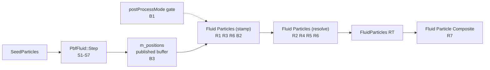
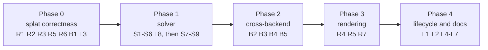
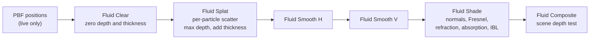

# Backyard Scene 8 Particle Fluid: Diagnosis and Fix Plan

> Follow-up (2026-11-08): [diagnosis-2.md](diagnosis-2.md) records the screen-space renderer,
> the GL image-origin fix, and the issues that remain after this plan's phases.
> [diagnosis-3.md](diagnosis-3.md) and
> [diagnosis-3-implementation.md](diagnosis-3-implementation.md) are the current SSFR review,
> plan and implementation status (F32 scatter depth, corrected normals, compositing).

Status: diagnosed 2026-11-07 against the uncommitted scene-8 working tree on `master` (base
commit `0cd4e96`). Vulkan findings were reproduced on Linux with the existing
`T850/bin/SteamDeck/Release/DayScene` build (NVIDIA RTX PRO 6000). D3D11, D3D12 and OpenGL
findings come from source, manifest and validator analysis and are **not yet reproduced
on-device**. The diagnosis changed no engine code.

**Implementation status (2026-11-08):** Phase 0, Phase 1, R4, B2, B3, B4 and B5 are
implemented. Vulkan is verified natively; D3D11/D3D12 are verified through DXVK/vkd3d-proton on
the Windows build; OpenGL creates every PBF and particle compute pipeline and runs the solver
through the regenerated twins, and the GL image-origin bug is fixed (the frame matches Vulkan).
R7 is implemented as a runtime-selectable screen-space renderer (surface depth, four-pass
smoothing, depth normals, Fresnel/refraction/absorption); all scene tuning is in
`Assets/Scenes/Backyard8Fluid.json`. See
[Implementation status](backyard8-particle-fluid-investigation.md#implementation-status--phase-0-phase-1-and-r4)
for the measured results and the documented deviations (artificial pressure disabled, XSPH
coefficient 0.15, contact velocity damping). B2 binds the 60-DWORD splat cbuffer as a root CBV
(`10/64`); B3 converted the PBF buffers to `float4`/`SolidBox`; the D3D11 black RT was an FXC
dispatch-coordinate loss fixed by scalar `pixelX/pixelY` capture. B4 regenerated 45 GLSL twins
(BOM-less, checker passes); B5 registers the new files in the VS filters
(`ValidateBuildRegistration.ps1` PASS). R5 durable and a native Windows driver run remain.
The screen-space gap analysis is in [screen-space fluid](backyard8-screen-space-fluid.md).

Where this document and the [investigation record](backyard8-particle-fluid-investigation.md)
disagree, this document is current. [Section 7](#7-corrections-to-the-investigation-record)
lists the corrected claims.

## 1. Purpose

Backyard scene 8 (`Backyard8Scene`) drops a sphere of water into the pool, simulates it with
GPU Position Based Fluids (PBF; Macklin and Müller, SIGGRAPH 2013,
<https://mmacklin.com/pbf_sig_preprint.pdf>) and draws the particles through the generic
`ParticleSystem` splat. The water either does not appear or appears as a pale, blocky disc.

This document lists every defect found, the evidence for each, a fix proposal per defect, and
a phased implementation plan with acceptance criteria for implementing agents.

## 2. Summary

Four groups of defects combine:

| Group | Effect | Findings |
|---|---|---|
| Splat renderer | On every backend the water is drawn in the wrong place, at about a third of its size, as tile-aligned 8x8 blocks, with no occlusion and no water shading | R1–R7 |
| Backend and configuration blockers | Nothing is drawn in the engine's default raster post-process mode, on native D3D12, on OpenGL, or at 4K-class resolutions; D3D11 reads particle data through mismatched strides | B1–B5 |
| PBF solver | The fluid has almost no incompressibility: the sphere flattens into one particle layer on the pool floor while particles are fired at the 12 m/s velocity cap | S1–S9 |
| Lifecycle and hygiene | Re-seeding leaves dangling buffer pointers; heavy log spam; wasted GPU work | L1–L8 |

Fixing the renderer alone would show a correctly placed sphere falling and then a thin film on
the pool floor. All four groups need fixing.



## 3. Evidence

### E1. The particles are projected with a transposed matrix

The 26,305 seeded particles were projected offline with the scene-8 camera built exactly as
`Camera::Update` builds it (eye `(0, 2.4, -13.5)`, pitch 0.22, fov 0.8, left-handed,
960x540). The camera model was checked against the dump: it places the pool's far and near
coping edges at y = 293 and y = 442, and the albedo dump has edges at y = 291–297 and y = 437.

| Projection | Splat bbox at t ≈ 0 (px) | Median splat radius |
|---|---|---|
| Correct, row-vector (`p * VP`) | x[211,750] y[-30,269] | 10.5 px |
| What `CS_ParticleSplat.hlsl` computes (`dot(VP[i], p)`) | x[390,570] y[101,229] | 3.9 px |
| `RT_Dump_FluidParticles`, frame 6 | x[392,567] y[96,231] | — |

The rendered water matches the transposed transform, not the camera.

### E2. Every splat fills whole 8x8 tiles

Every extent in the particle target lies on an 8-pixel tile boundary: frame 6 spans x 392→568
and y 96→232; frame 300 spans x 200→760 and y 144→384. Isolated particles at frame 300 render
as 8x8 squares with a dark centre.

### E3. Raster post-process mode draws nothing

With `--postProcessMode raster` the log reports
`Pass 'Fluid Particles (stamp)' using graphics implementation by post-process mode` at INFO
level for both particle passes, and `RT_Dump_FluidParticles` has 0 non-zero pixels.

### E4. The solver flattens the fluid

300 frames at a fixed 1/60 s with `--pbf-diagnostics 30`:

| t (s) | meanY | maxY | aboveRim | maxSpeed |
|---|---|---|---|---|
| 0.50 | 2.194 | 4.522 | 26,123 | 5.30 |
| 1.00 | -1.050 | 1.963 | 2,188 | 11.97 |
| 1.50 | -1.511 | 5.748 | 111 | 12.00 |
| 2.00 | -2.106 | 7.080 | 240 | 11.99 |
| 3.00 | -3.177 | 5.102 | 185 | 12.00 |
| 5.00 | -10.202 | 3.482 | 330 | 11.98 |

- Free fall to t = 0.5 s is correct.
- The column-height dump at t = 5 s (`ReadColumnHeights`, 100x50 texels, 4,850 wet) has a
  median and 10th-percentile column top 1.495 m below the water plane. That is the floor clamp
  (`basinMinY + 0.5 * spacing`). The 90th percentile is −0.18 m. The water is a single particle
  layer on the floor.
- `maxSpeed` sits at the 12 m/s cap from t = 1 s on, and `maxY` reaches 7.08 m, which matches
  a 12 m/s vertical launch (12² / 2g ≈ 7.3 m).
- `meanY` sinks below the floor because particles parked at y = −1000 are still averaged.
  About 1% (~240) are parked by t = 5 s.

### E5. Validators and manifest

- `python3 T850/scripts/validation/check_gl_twins.py --shaders T850/Assets/Shaders`:
  `CS_ParticleSplat.glsl` is stale and binds `[0..6]` where `compute_kernels.json` declares
  `[0..4]`; `CS_PbfUpdateVelocity.glsl` is stale. Both kernels are new in this work.
- D3D12 root cost computed from `compute_kernels.json`: `particle_splat` = 60 constant DWORDs +
  3 root SRV/UAV × 2 + 1 UAV table = **67 DWORDs**, over the 64-DWORD limit. For comparison,
  `torch_particles` = 62 and `god_rays` = 57.
- `check_fluid_constants.py` passes, but it only scans `CS_Fluid*.hlsl`; it does not cover
  `CS_Pbf*` or `CS_ParticleSplat`.

### E6. Log volume

The 300-frame run wrote 30,148 log lines; 29,100 of them are `[PBFDBG]` (about 97 per frame).

### Reproduction commands

Source root `T850/`, Linux host:

```bash
cd bin/SteamDeck/Release
export LD_LIBRARY_PATH=/usr/lib/x86_64-linux-gnu
COMMON="--unattended --api vulkan --scene 8 --backyard-no-hud --width 960 --height 540 --regressionFixedDt 0.0166667 --logLevel info"
./DayScene $COMMON --postProcessMode compute --dump-frame 6 > /tmp/b8_f6.log 2>&1        # E1, E2
./DayScene $COMMON --postProcessMode raster  --dump-frame 6 > /tmp/b8_raster.log 2>&1    # E3
./DayScene $COMMON --postProcessMode compute --pbf-diagnostics 30 --dump-frame 300 > /tmp/b8_sim.log 2>&1   # E4
grep "\[pbf\] t=" /tmp/b8_sim.log
```

Measure the particle target of the newest frame-6 dump (compute mode):

```bash
python3 - <<'EOF'
import glob, numpy as np
from PIL import Image
d = sorted(glob.glob('dumps_vulkan_f6_*'))[-1]
a = np.asarray(Image.open(d + '/RT_Dump_FluidParticles.ppm').convert('RGB'))
ys, xs = np.nonzero(a.max(axis=2))
print(d, len(xs), 'px  bbox x[%d,%d] y[%d,%d]' % (xs.min(), xs.max(), ys.min(), ys.max()))
print('tile aligned:', all(v % 8 == 0 for v in (xs.min(), xs.max() + 1, ys.min(), ys.max() + 1)))
EOF
```

Dump folders (`dumps_vulkan_f*_*`) are written to the working directory and are safe to delete.
The column-height CSV is currently written to `/tmp/opencode/pbf_surface.csv` (see L3).

## 4. Findings

| ID | Severity | Area | Location | Defect |
|---|---|---|---|---|
| R1 | Blocker | Splat | `T850/Assets/Shaders/CS_ParticleSplat.hlsl:108`, `T850/Framework/src/utils/ComputeKernelRegistry.cpp:401` | View-projection applied transposed |
| R2 | Blocker | Splat | `CS_ParticleSplat.hlsl:255`, `:261`, `:265` | Splat falloff inverted; whole tiles filled |
| R3 | Minor | Splat | `CS_ParticleSplat.hlsl:194` | Pixel radius ignores the projection scale |
| R4 | Major | Splat | `CS_ParticleSplat.hlsl:33`, `ParticleSystemDesc::depth_bias` | No depth test against the scene |
| R5 | Major (performance) | Splat, graph | `CS_ParticleSplat.hlsl:241`, `T850/Framework/src/scene/RenderGraph.cpp:941` | Every pixel loops over every particle; tile masks never cleared |
| R6 | Blocker at ≥ 4.2 MP | Graph | `RenderGraph.cpp:326`, `RenderGraph.cpp:1309` | Both passes dispatched as a 1D grid over W×H threads |
| R7 | Major (appearance) | Shading | `CS_ParticleSplat.hlsl`, `FS_Quad.hlsl` `PARTICLE_COMPOSITE` | Flat colour average cannot look like water |
| B1 | Blocker (default config) | Graph | `T850/Framework/include/core/Config.h:87`, `RenderGraph.cpp:1154` | Particle passes disabled unless `postProcessMode` is `compute` |
| B2 | Blocker on D3D12 | Kernel, D3D12 | `compute_kernels.json` `particle_splat`, `T850/Framework/src/video/d3d12/D3D12Compute.cpp:261` | Root signature needs 67 DWORDs; limit is 64 |
| B3 | Blocker on D3D11 | Kernels, buffers | `T850/Framework/src/simulation/PbfFluid.cpp:385`, `:168`; all `CS_Pbf*.hlsl`; `CS_ParticleSplat.hlsl:84`; `T850/Framework/src/video/d3d11/D3D11Compute.cpp:156` | Buffers created with 16/32-byte strides; shaders declare 4-byte elements |
| B4 | Blocker on OpenGL | GL twins | `CS_ParticleSplat.glsl`, `CS_PbfUpdateVelocity.glsl` | Stale twins; the splat twin has the wrong binding layout |
| B5 | Minor | Build | `T850/Framework/Framework.vcxproj.filters` | New Framework files missing from the filters |
| S1 | Blocker (physics) | Solver | `T850/Assets/Shaders/CS_PbfSolve.hlsl:255` | Position correction divided by the neighbour count |
| S2 | Major | Solver | `T850/DayScene/Backyard8Scene.cpp:132`, `PbfSettings` defaults | Smoothing radius h = 4 × spacing (~250 neighbours) |
| S3 | Major | Solver | `CS_PbfDensity.hlsl:136`, `:214`, `:218` | Wall mirroring, neighbour gate and λ clamp replace eq. 11 conditioning |
| S4 | Major | Solver | `CS_PbfUpdateVelocity.hlsl:151` | No vorticity confinement; XSPH reads pre-solve neighbour velocities |
| S5 | Major | Solver | `CS_PbfIntegrate.hlsl:166`, `CS_PbfCull.hlsl:71` | Parked particles re-enter the simulation every substep |
| S6 | Major | Scene | `T850/DayScene/Application.cpp:655`, `Backyard8Scene.cpp:189` | Variable, unclamped time step |
| S7 | Major (hypothesis) | Solver | `CS_PbfIntegrate.hlsl:126`, same code in `CS_PbfSolve.hlsl` | Box push-out can launch particles at the speed cap |
| S8 | Minor | Scene | `Backyard8Scene.cpp:133` | Sphere wider than the pool and ~93% of its volume |
| S9 | Minor | Solver | `CS_PbfIntegrate.hlsl:151` | Wind drags the whole airborne sphere |
| L1 | Major (crash) | Lifecycle | `PbfFluid.cpp:463`, `Backyard8Scene.cpp:177` | Re-seeding frees published buffers |
| L2 | Minor | Ownership | `PbfFluid.cpp:236`, `:633` | Solver clears both global particle registries |
| L3 | Major on Windows | Hygiene | `PbfFluid.cpp:435`, `Backyard8Scene.cpp:209` | Temporary instrumentation still active |
| L4 | Minor | Performance | `PbfFluid.cpp:585` | Heightfield passes run although the water mesh is hidden |
| L5 | Minor | Logging | `Backyard8Scene.cpp:172` | Format string has 4 specifiers and 3 arguments |
| L6 | Minor | Controls | `Backyard8Scene.cpp` start mode, `T850/DayScene/App.cpp` `--pbf-overflow` | Start mode ignored; flag unused |
| L7 | Minor | Lifecycle | `PbfFluid::Shutdown`, `Backyard8Scene::InitPbf` | Pipelines left alive; surface bound before the mesh exists |
| L8 | Minor | Diagnostics | `PbfFluid::ReadDiagnostics` | Parked particles counted in the averages |

## 5. Fix proposals

### 5.1 Renderer

#### R1. Transposed view-projection

`Camera::VP` is `View * Projection` in the D3D row-vector convention
(`T850/Framework/src/utils/Camera.cpp:218`; `XMatPerspectiveLH` sets `m[2][3] = 1`).
`BuildParticleSplatConstants` copies it raw into `float4 ViewProjection[4]`, so
`ViewProjection[k]` holds row k. The kernel computes `dot(row, p)`, which is the column-vector
product. The comment above `Transform` that justifies it is wrong; the old GL twin and
`CS_PbfParticles.hlsl` used the correct form.

```hlsl
// ViewProjection[k] is row k of the row-vector matrix:
// clip = p.x*row0 + p.y*row1 + p.z*row2 + row3.
float4 Transform(float3 p)
{
    return p.x * ViewProjection[0] + p.y * ViewProjection[1] +
           p.z * ViewProjection[2] + ViewProjection[3];
}
```

Do not also transpose on the host. `CS_TorchParticles.hlsl` uses `mul(ViewProjection, p)` on a
`float4x4` cbuffer member, which is correct only because of HLSL's default column-major packing;
leave that kernel as it is.

#### R2. Inverted falloff

`smoothstep(r, r*(1-Softness), d)` is already 1 at the centre and 0 at `r`. The following
`shape = 1.0f - shape` inverts it, so every pixel farther than `r` gets weight 1 inside each tile
the particle's bounding box touches, and the centre gets 0. Reversed edges are also undefined
in GLSL and SPIR-V.

```hlsl
const float inner = r * (1.0f - max(Softness, 1e-3f));   // edge0 < edge1
// sphere: length(delta); sprite: max(abs(delta.x), abs(delta.y));
// streak: length(delta * float2(1.0f, 0.25f))
shape = 1.0f - smoothstep(inner, r, d);                   // 1 at the centre, 0 at r
```

Apply this to all three shape branches and delete the `shape = 1.0f - shape;` lines. This
defect, not tile marking, produced the "8 px staircase" recorded as B7 in the investigation.

#### R3. Pixel radius

The projected radius in pixels is `R * P11 * (H / 2) / w`, with
`P11 = Projection.m[1][1] = cot(fov / 2)`. The kernel uses `R * H / w`: 15% too small at
fov 0.8 and too large at wider fields of view. Pass `camera->Projection.m[1][1]` in a cbuffer
pad (for example `Pad0`, renamed `ProjScaleY`):

```hlsl
const float radiusPx = Radius * sizeScale * ProjScaleY * 0.5f * float(OutputHeight) / max(clip.w, 1e-3f);
```

#### R4. Depth test

`ParticleSystemDesc::depth_bias` is documented as "fade the splat out past this depth
difference", but no depth texture is bound and `DepthBias` is unused. The water draws over the
coping, deck and pergola posts in front of it.

- Bind `GBuffer:DEPTH` as a `sampled` resource to the pass that writes colour. A
  `Texture2D<float>` read with `Load` needs no sampler.
- The projection is reversed-Z: `d = n/(n-f) + n*f / ((f-n)*z)` maps the near plane to 1 and
  the far plane to 0. Linear view depth is `z = n*f / ((f-n)*d + n)`.
- `Projected[i].w` stores `clip.w`, which equals view-space z for this projection.
- Soft-particle weight: `fade = saturate((sceneZ - (particleZ - Radius)) / max(DepthBias, 1e-3))`;
  multiply the splat weight by it. Pass `n` and `f` (`camera->NPlane`, `camera->FPlane`) in
  the cbuffer.
- This adds one descriptor table to the D3D12 root signature, so B2 must be fixed first.

#### R5. Resolve cost and stale tile masks

Each pixel of a marked tile loops over all `ParticleCount` particles
(`CS_ParticleSplat.hlsl:241`), so cost is (pixels in marked tiles) × 26k. The tile masks are
zeroed only when the buffer is created (`RenderGraph.cpp:941`), and `InterlockedOr` accumulates
forever, so every tile the fluid ever crossed stays marked and the cost keeps growing. At 1080p
and above on mid-range GPUs this risks a Windows GPU timeout (TDR).

- Immediate fix, no new driver API: stamp tiles with a frame index instead of a bit. Add
  `uint32_t frameIndex` to `ComputeKernelConstantsContext`, incremented once per
  `RenderGraph::Execute` and starting at 1, and pass it in the cbuffer (for example `Pad1`):

  ```hlsl
  InterlockedMax(TileMasks[tile], FrameIndex);                    // stamp
  if (TileMasks[tile] != FrameIndex) { /* write 0 and return */ }  // resolve
  ```

- Durable fix: replace the gather with a scatter ([section 8](#8-planned-screen-space-fluid-rendering)):
  each particle writes only the pixels inside its disc with atomics, which costs
  particles × disc area instead of pixels × particles. Per-tile index lists (count, prefix sum,
  scatter) are the alternative if the gather is kept.

#### R6. Dispatch shape

The pass expansion forces `compute_extent_from = pass.target` (`RenderGraph.cpp:326`), and the
executor dispatches particle passes as a 1D grid of `W × H` threads (`RenderGraph.cpp:1309`).
Above 65,535 × 64 = 4,194,240 pixels (3440×1440, 3840×2160) both passes are rejected as
`[DispatchTooLarge]` and nothing is drawn. The stamp also launches 518,400 threads for 26,305
particles at 960×540, and it would skip particles if `W × H < ParticleCount`.

- Minimal fix: delete the particle-specific 1D branch (`RenderGraph.cpp:1308`), so the generic
  branch dispatches `(ceil(W/64), H)` groups for the existing `[numthreads(64,1,1)]`. In the
  kernel, the resolve uses `pixel = id.xy`, and the stamp uses
  `i = id.x + id.y * (ceil(OutputWidth / 64) * 64)` with the existing `i < ParticleCount` check.
  This removes the 4K failure but keeps the stamp tied to the screen size.
- Preferred fix: split the splat into two manifest kernels. `CS_ParticleStamp.hlsl` binds
  constants, positions, projected and tile masks; `CS_ParticleResolve.hlsl` binds constants,
  projected and tile masks (read-only), the output texture and the scene depth. Give the stamp
  `compute_extent_from = "__particle_projected_<name>"` (1D over the particle count) and the
  resolve `compute_extent_from = pass.target` (2D). Two engine changes go with it:
  - `BuildParticleSplatConstants` takes `OutputWidth`/`OutputHeight` from the dispatch extent.
    Add `targetWidth`/`targetHeight` to `ComputeKernelConstantsContext`, filled from the pass's
    target render target, and use them.
  - The executor's runtime check at `RenderGraph.cpp:1295` fails any storage-texture binding when
    the extent is a buffer, while the load-time check at `RenderGraph.cpp:644` skips that case.
    Make the two agree. The split removes the storage texture from the stamp, so this only
    matters if a single kernel is kept.
- The split also shrinks each kernel's cbuffer, which helps B2.

#### R7. Shading

The splat writes a weighted average of a fixed colour ramp plus a coverage alpha into an HDR
target, and `PARTICLE_COMPOSITE` blends it with straight alpha. With no normal, refraction,
reflection or absorption it reads as a pale translucent sticker. The PBF paper renders with
ellipsoid splatting and screen-space filtering (§7). [Section 8](#8-planned-screen-space-fluid-rendering)
describes the planned pipeline.

### 5.2 Backend and configuration blockers

#### B1. Raster post-process mode disables the particle passes

`Config::postProcessMode` defaults to `Raster` (`Config.h:87`; also the Launcher's first
option), and `RenderGraph::CreateComputePipelines` creates no pipeline for any
`compute_if_supported` pass in raster mode (`RenderGraph.cpp:1154`). The particle passes have
`draws: []`, so `FluidParticles` stays empty, and the skip is logged only at INFO. The
investigation always ran with `--postProcessMode compute`, which hid this.

```cpp
// RenderGraph::CreateComputePipelines: particle passes have no raster implementation;
// postProcessMode only selects between CS and PS versions of optional effects.
const bool computeOnly = !pass.particle_system.empty();
if (!computeOnly && g_config.postProcessMode != Config::PostProcessMode::Compute) {
  // existing "using graphics implementation by post-process mode" path
}
```

- When a compute-only pass still ends up without a pipeline (`SupportsComputeTextures()` false or
  pipeline creation failure), log one ERROR naming the pass and the cause, and skip the passes
  that sample its target (for scene 8, `Fluid Particle Composite`). A generic graph rule is
  better than a scene-specific check.
- Add `"clear": true, "clear_color": [0, 0, 0, 0]` to the `Fluid Particles` pass in
  `Backyard8Scene_RenderGraph.json`, so the graphics fallback leaves a transparent target rather
  than whatever the backend's render-target load produces.
- Document the rule in `documentation/rendering/render-graph.md`.

#### B2. D3D12 root signature over 64 DWORDs

On D3D12, root constants cost 1 DWORD each, root SRV/UAV descriptors 2 and descriptor tables 1,
and the total may not exceed 64. `D3D12Compute.cpp:261` checks only the constant block.
`particle_splat` needs 67, so `D3D12SerializeRootSignature` fails, the pipeline is never
created, and the pass falls back to an empty graphics pass. A Proton run exiting 0 does not show
that the splat ran: the fallback also exits 0.

- Immediate: keep every splat kernel at 64 DWORDs or less in total. Options: pack the four ramp
  colours with `f32tof16` (2 DWORDs each instead of 4, saving 8), drop procedural-only fields for
  buffer systems, or rely on the R6 split, which gives each kernel a smaller cbuffer.
- Durable: when the total exceeds 64, make the D3D12 backend place the cbuffer in a root CBV
  (`D3D12_ROOT_PARAMETER_TYPE_CBV`, data from the existing ring allocator with 256-byte
  alignment, `SetComputeRootConstantBufferView`). Also compute and log the D3D12 root cost of
  every manifest kernel at load on all backends, so the budget is visible where it is not
  enforced.

#### B3. D3D11 structured-buffer stride mismatch

`PbfFluid` creates the particle buffers with `structureStride = 16` (`PbfFluid.cpp:385`) and
the solid-box buffer with 32 (`PbfFluid.cpp:168`). Every `CS_Pbf*` kernel and the splat's
`Positions` declare `StructuredBuffer<float>` or `RWStructuredBuffer<float>` (4-byte elements)
and index `i * 4 + c`. D3D11 builds its views from the creation stride
(`D3D11Compute.cpp:156`), so the view and shader strides differ: a debug-layer error and
undefined behaviour on native drivers. Vulkan, OpenGL, WebGPU and D3D12 (root descriptors)
carry no stride and work by accident. A Proton (DXVK) run is not evidence either way.

```hlsl
RWStructuredBuffer<float4> Positions : register(u0);    // xyz, w = alive flag (see S5)
float3 LoadPosition(uint i) { return Positions[i].xyz; }

struct SolidBox { float4 lo; float4 hi; };               // 32 bytes == boxDesc.structureStride
StructuredBuffer<SolidBox> SolidBoxes : register(t0);

RWStructuredBuffer<float4> Lambda : register(u0);        // lambda, density, |sum grad C|^2, neighbours
```

- Apply this to `Positions`, `Predicted`, `PredictedNext`, `Velocities`, `VelocitiesNext`,
  `Lambda`, `SolidBoxes`, `CS_PbfCopyFields` and the splat's `Positions`. The grid and
  column-height buffers already use 4-byte elements.
- Durable guard: at dispatch, compare the reflected element stride (D3D reflection reports it for
  structured buffers; SPIR-V reflection reports `ArrayStride`) with the bound buffer's
  `descriptor.structureStride` on every backend, so the mismatch also fails on Vulkan.

#### B4. Stale GL twins

`CS_ParticleSplat.glsl` was generated from an older HLSL. It binds seven resources (including a
view-projection buffer and a velocity buffer), still uses `age = 1.0` for buffer particles and
the old front-to-back alpha, so OpenGL rejects or misrenders it. `CS_PbfUpdateVelocity.glsl` is
stale too.

```powershell
# Windows, source root T850\ (pwsh is not installed on the Linux host)
.\scripts\shaders\generate_gl_compute_twins.ps1 -Force
```

```bash
python3 T850/scripts/validation/check_gl_twins.py --shaders T850/Assets/Shaders
python3 T850/scripts/validation/check_fluid_constants.py
```

Regenerate after the R-, B3- and S-series HLSL changes, not before. Extend
`check_fluid_constants.py` to scan `CS_Pbf*.hlsl` and `CS_Particle*.hlsl`; it currently scans
only `CS_Fluid*.hlsl`.

#### B5. Build registration

`ParticleSystem.cpp/.h`, `PbfFluid.cpp/.h` and `PoolLayoutJson.h` are listed in
`Framework.vcxproj` and `Framework/CMakeLists.txt` but not in `Framework.vcxproj.filters`. Add
them, then run `scripts/ValidateBuildRegistration.ps1` on Windows.

### 5.3 Solver (alignment with the PBF paper)

The paper's loop (Algorithm 1): apply forces and predict positions; find neighbours; for a fixed
number of iterations compute λ_i (eq. 11), compute Δp_i with s_corr (eq. 14) together with
collision response, and apply Δp; finally update v = (x* − x)/Δt, apply vorticity confinement
and XSPH viscosity (eqs. 15–17), and commit x = x*. The paper uses a fixed iteration count
(typically 2–4) and 2–4 steps per 16 ms frame.

#### S1 and S2. Missing incompressibility (fix together)

- `CS_PbfSolve.hlsl:255–256` divides Δp by the neighbour count. Eq. 14 has no such factor. With
  ~250 neighbours the projection is ~250 times too weak, so the fluid compresses into a sheet (E4).
- The divide was added because the solver overshot, and it overshot because
  `smoothingRadius = 4 × s_particleRadius` (`Backyard8Scene.cpp:132`) where `s_particleRadius`
  is the lattice **spacing**. The common "h = 4 × particle radius" rule means h = 2 × spacing.
  At 4 × spacing each particle has ~250 neighbours, every lookup scans 125 grid cells (~1,000
  candidates), Jacobi updates overshoot, and every kernel is about 8 times more expensive. The
  paper notes that PBF does not need the SPH rule of 30–40 neighbours.

```cpp
// Backyard8Scene::InitPbf: s_particleRadius is the lattice SPACING
settings.particleRadius  = static_cast<float>(s_particleRadius);
settings.smoothingRadius = static_cast<float>(s_particleRadius) * 2.0f;   // ~33 neighbours

// PbfFluid::TryInitialize: neighbour grid cell = h (was h / 2)
const float cell = m_settings.smoothingRadius;
```

```hlsl
// CS_PbfBuildGrid / CS_PbfDensity / CS_PbfSolve / CS_PbfUpdateVelocity: cell = h, 27 cells
const float inv = 1.0f / SmoothingRadius;
for (int dz = -1; dz <= 1; ++dz) for (int dy = -1; dy <= 1; ++dy) for (int dx = -1; dx <= 1; ++dx) { /* ... */ }

// CS_PbfSolve.hlsl: eq. 14 as published, no neighbour-count factor
dp *= 1.0f / RestDensity;
```

- Rename `PbfSettings::particleRadius` to `particleSpacing` (the collision margin stays
  `0.5 * spacing`) and fix the `PbfSettings` defaults and comments
  (`smoothingRadius = 0.52f; // h = 4 x radius`).
- `LatticeRestDensity` and `LatticeGradSq` recompute the kernel normalisation automatically for
  the new h. A cell of size h holds 8 particles at rest, so the 64-slot capacity covers 8x
  compression.

#### S3. Constraint conditioning

Remove the workarounds that compensated for S1/S2 and follow eq. 11:

- Delete the wall-mirroring block (`CS_PbfDensity.hlsl:136`). It adds density without a gradient
  term, so λ is inconsistent, and it mirrors across walls above the rim, outside the pool
  footprint and at the top of the neighbour domain.
- Delete the `MinNeighbours` gate (`:214`) and the λ clamp (`:218`). Keep `maxStep` in the solve
  only as a safety net and count how often it fires.
- Use a real relaxation ε:
  `denom = |Σ∇C|² + Σ|∇C|² + StiffnessEps * RestDenomReference`, with `StiffnessEps` in the
  0.01–0.1 range (the default is 1e-6). Expose it in the Dev GUI.
- For under-density at the free surface and walls: the paper (§4) notes that clamping pressures
  to be non-negative avoids clustering "at the cost of reduced particle cohesion". Start with the
  unilateral constraint, which is what most real-time PBF implementations use:

  ```hlsl
  const float constraint = max(density / RestDensity - 1.0f, 0.0f);
  ```

- Keep s_corr (k = 0.1, n = 4, |Δq| = 0.1h–0.3h). If particles stack along walls, add Akinci et
  al. 2012 boundary particles applied to both density and gradient; the paper names this as its
  own limitation.

#### S4. Vorticity confinement and XSPH order

Algorithm 1 computes v_i = (x*_i − x_i)/Δt for every particle first, then applies vorticity
confinement and XSPH. `CS_PbfUpdateVelocity` uses the new velocity for particle i but the
pre-solve velocity buffer for neighbours (`:151`), and vorticity confinement is missing. Split
the work into three kernels, each with a manifest entry and a GL twin:

1. `CS_PbfVelocity.hlsl`: v_i = (x*_i − x_i)/Δt, clamped, into `VelocitiesNext`.
2. `CS_PbfVorticity.hlsl`: eq. 15, ω_i = Σ_j (v_j − v_i) × ∇_pj W(p_i − p_j), where
   ∇_pj W = −SpikyGrad(p_i − p_j). Write `float4(ω, |ω|)`.
3. `CS_PbfUpdateVelocity.hlsl`: η = Σ_j (|ω_j| − |ω_i|) ∇W_ij, N = η / (|η| + 1e-6),
   f = ε_vort (N × ω_i) (eq. 16), v += Δt f; XSPH (eq. 17) v += c Σ_j (v_j − v_i) W_ij with
   c = 0.01 and the normalised Poly6 kernel; write `Velocities`; commit `Positions = Predicted`.

Start `ε_vort` small and expose it in the Dev GUI.

#### S5. Make retired particles inert

`CS_PbfCull` parks particles at y = −1000, but the next `CS_PbfIntegrate` runs `Collide` on
them. Outside the pool footprint the deck clamp lifts every parked particle to (0, 0.185, 0),
where they share one clamped grid cell, receive v = (0.185 + 1000)/Δt (about 120 km/s, clamped to
12 m/s), and are parked again by the cull at the end of the step.

- Seed with `w = 1` (alive); the cull sets `w = 0` and parks the particle.
- `CS_PbfIntegrate`: if `w == 0`, copy the position to `Predicted` and return (no forces, no
  collision).
- `CS_PbfBuildGrid`: do not insert dead particles, so no neighbour loop sees them.
- `CS_PbfDensity`, `CS_PbfSolve`, `CS_PbfUpdateVelocity`: return early for dead particles, writing
  pass-through values where a later copy reads them (`PredictedNext = Predicted`).
- Splat stamp: write `Projected[i].z = -1` for dead particles.
- `ReadDiagnostics`: count dead particles and exclude them from the averages (L8).

#### S6. Fixed time step

`DtSecs` comes straight from the frame timer (`Application.cpp:655`), and
`Backyard8Scene::OnUpdate` passes it to the solver with no upper bound (`Backyard8Scene.cpp:189`).
A hitch (shader compilation, log spam, a window drag) produces a large Δt that the position
projection cannot absorb. A held frame (dt = 0) still steps 1/60 s.

```cpp
// Backyard8Scene::OnUpdate (new member: float m_pbfAccumulator = 0.0f)
constexpr float kStep = 1.0f / 60.0f;              // substeps stay inside PbfFluid::Step
constexpr int kMaxStepsPerFrame = 3;
m_pbfAccumulator += (std::min)(deltaSeconds, kStep * kMaxStepsPerFrame);   // dt == 0 adds nothing
for (int n = 0; m_pbfAccumulator >= kStep && n < kMaxStepsPerFrame; ++n) {
  m_pbf.SetDeltaTime(kStep);
  if (!m_pbf.Step(driver)) break;
  m_pbfAccumulator -= kStep;
}
```

#### S7. Particles launched at the speed cap (confirm first)

The step-box push-out in `Collide` moves a penetrating particle along the shortest axis by up to
the box half-size plus the margin in one call (`CS_PbfIntegrate.hlsl:126`, duplicated in
`CS_PbfSolve.hlsl`). The velocity update turns that displacement into velocity, so a deep
penetration resolved upward becomes a launch. E4 (12 m/s maxima, 7 m apex) is consistent with
this, but the in-plane pressure of the floor sheet could also cause it.

- Confirm: after S1–S3, log the count and positions of particles at `maxVelocity` on each
  diagnostic frame.
- Fix: exit through the face nearest the previous position (`Positions[i]`) rather than along
  the shortest axis, limit the correction per call to about one spacing, or move to an analytic
  signed distance function for the pool (a union of boxes). The paper uses signed distance
  fields stored as volume textures.

#### S8. Initial sphere

The 2.4 m sphere is 4.8 m wide while the pool is 4.5 m deep in Z (−9.0 to −4.5), so two slices
land on the deck. Its 57.8 m³ is about 93% of the pool's ~62 m³ capacity (40.5 m² × 1.6 m minus
~2.6 m³ of steps), so any compression error overflows the rim. Use `sphereRadius = 2.0f` (about
15,250 particles at the current spacing, ~55% fill) and put the centre 1 m above the coping:
`sphereHeight = 3.08f` relative to the water plane (centre y = 3.04).

#### S9. Wind

`CS_PbfIntegrate.hlsl:151` drags every particle above `WaterPlaneY − spacing`, which is the whole
airborne sphere, not a surface layer. The paper has no wind. Restrict it to free-surface
particles using the previous step's density (`Lambda[i].y` below about 0.8 of rest), or remove
it until the fluid behaves correctly.

### 5.4 Lifecycle, ownership and hygiene

- **L1. Re-seeding.** `ResetToRest` calls `SeedParticles`, which recreates `m_positions` and
  `m_velocities` (`PbfFluid.cpp:463`), but `ApplyStartMode` (`Backyard8Scene.cpp:177`) never
  re-publishes them. `ParticleBufferRegistry` keeps the freed pointers and the render graph binds
  them (use-after-free). Preferred: create a read-only `m_seed` buffer once and reset by copying
  it into `m_positions`, `m_predicted` and `m_predictedNext` with the existing
  `CS_PbfCopyFields`, then zero the velocities, so buffer addresses never change. Minimal: call
  `PublishParticleBuffers(m_publishedPositionName, m_publishedVelocityName)` at the end of
  `SeedParticles` when the names are set.
- **L2. Registry ownership.** `TryInitialize` calls `Shutdown`, which calls
  `ParticleBufferRegistry::Clear()` and `ParticleSystemRegistry::Clear()` (`PbfFluid.cpp:236`,
  `:633`), wiping every system, not only the solver's. Add `Remove(name)` to both registries;
  `PbfFluid` removes only the buffers it published, and `Backyard8Scene::OnDestoryScene` removes
  `BackyardWater`.
- **L3. Temporary instrumentation.** Remove the `[PBFDBG]` block and the `liveBuffers` array in
  `PbfFluid.cpp` (`:435` and `Step`), the `[Backyard8][dbg]` logs, and the
  `/tmp/opencode/pbf_surface.csv` writer (`Backyard8Scene.cpp:209`), which does not work on
  Windows or Android. Replace the CSV with a summary in the `[pbf]` log line (10th, 50th and 90th
  percentile column-top heights and the wet texel count).
- **L4. Heightfield work.** `PbfFluid::Step` runs three heightfield dispatches every frame
  (`PbfFluid.cpp:585`) although scene 8 hides the water mesh. Do not create `m_waterSurfaceRT` or
  call `SetSurfaceOutput` while the mesh is hidden, or keep the heightfield only as an opt-in
  diagnostic.
- **L5. Format string.** `Backyard8Scene.cpp:172` prints `start=%d` without an argument (it logged
  `start=-2045857019`). Pass `s_startMode`.
- **L6. Start mode.** The Dev GUI start-mode combo and `--backyard-start` change nothing in scene
  8 because `SeedParticles` always seeds the sphere, and `--pbf-overflow` is parsed but unused.
  Implement the modes or remove the controls.
- **L7. Shutdown and ordering.** `PbfFluid::Shutdown` does not reset `m_cull` or `m_copyFields`.
  `InitPbf` binds the surface texture to `m_waterHandle` before `BackyardScene::CreateAssets`
  creates the mesh, so the binding never happens; this is harmless only while the mesh is hidden.
- **L8. Diagnostics.** `ReadDiagnostics` averages parked particles (the falling `meanY` in E4).
  Exclude dead particles and report the dead count, the mean and maximum density
  (`Lambda[i].y`), and the number of `maxStep` and `maxVelocity` clamps per step.

## 6. Implementation plan

Run the phases in order; each ends with its acceptance check. Linux/Vulkan commands are in
[section 3](#reproduction-commands); Windows commands are in Phase 2.



### Phase 0: splat correctness (Linux, Vulkan)

Items: R1, R2, R3, R5 immediate fix (frame-stamped tile masks), R6 minimal fix, B1, L3.

Acceptance:

- Frame 6 at 960×540 (section 3 command): the `FluidParticles` bbox is about x[205,755]
  y[0,275] (the top of the sphere is above the screen), `tile aligned: False`, and the
  silhouette is round and soft.
- `--postProcessMode raster`: the log shows `dispatched compute` for both particle passes (or a
  single ERROR and the composite skipped, when compute is unavailable).
- `--width 3840 --height 2160`: no `[DispatchTooLarge]`.
- Fewer than 100 log lines per second at `--logLevel info`.

### Phase 1: solver (Linux, Vulkan)

Items: S1 and S2 together, S3, S5, S6, L8; then S8, S7, S9, S4.

Acceptance, using `--pbf-diagnostics 30` over 600 frames (10 s at 1/60 s):

- t = 0.5 s: free fall unchanged (centre drop ≈ 1.23 m).
- From t = 6 s: live-particle mean speed below 0.1 m/s; maximum speed below 1 m/s and never at
  `maxVelocity`; fewer than 0.5% of live particles above the rim; dead count stable.
- Settled median column top within ±0.1 m of the expected level. With `sphereRadius = 2.0` the
  surface settles at y ≈ −0.72 m (about 0.68 m below the water plane); with 2.4 it settles just
  below the water plane.
- Interior particle density within 3% of rest; `maxStep` clamps near zero after settling.
- Re-run the Phase 0 checks: the falling sphere keeps its shape and volume before impact.

### Phase 2: cross-backend (Windows)

Items: B2, B3, B4, B5. Make the HLSL changes first and regenerate the GL twins last.

```powershell
# Source root T850\
.\scripts\build.ps1 -Config Release -Platform x64 -Action Build
cd .\bin\x64\Release
foreach ($api in 'd3d11', 'd3d12', 'gl', 'vulkan') {
  .\DayScene.exe --unattended --api $api --scene 8 --backyard-no-hud --width 960 --height 540 `
    --regressionFixedDt 0.0166667 --dump-frame 6 --postProcessMode compute --logLevel info *> "b8_$api.log"
}
.\DayScene.exe --unattended --game-selftest      # expect 78 PASS lines and exit code 0
```

Acceptance:

- Every log shows `enabled compute kernel` and `dispatched compute` for both particle passes, and
  no `Root signature serialization failed`, `failed to create compute pipeline` or
  `compute dispatch failed`.
- Each API's `RT_Dump_FluidParticles` bbox matches the Vulkan result within a few pixels.
- D3D12 with `--d3d12debug`, and D3D11 in a `DEBUG_DRIVER` build, report no structured-buffer
  stride errors.
- `check_gl_twins.py` reports no failure for `CS_Pbf*` or `CS_Particle*`, and
  `ValidateBuildRegistration.ps1` passes.
- Record the per-backend status in `documentation/rendering/render-graph.md`. Runs through Proton
  (DXVK, vkd3d-proton) do not count as D3D verification; they hid B2 and B3.

### Phase 3: rendering (all backends)

Items: R4, R5 durable fix (scatter), R7 ([section 8](#8-planned-screen-space-fluid-rendering)).

Acceptance:

- Water inside the pool is hidden by the near coping and the deck, and water behind the pergola
  posts is hidden by the posts.
- The surface shows refraction of the pool floor, a Fresnel reflection of the sky and
  depth-dependent absorption; the particle lattice is not visible at the default camera.
- Target: the fluid passes take 2 ms or less of GPU time at 1920×1080 on the development GPU,
  measured per pass with GPU timestamps ([GPU timestamp profiling](../rendering/gpu-timestamp-profiling.md)).
  Record the Steam Deck figure.

### Phase 4: lifecycle and documentation

Items: L1, L2, L4–L7. Then:

- Re-run `--game-selftest` (78 PASS) and smoke-test scenes 0, 1, 2, 6, 7 and 8, checking scene 7
  explicitly for regressions.
- Update the [investigation record](backyard8-particle-fluid-investigation.md) (or fold it into
  this document), `documentation/rendering/render-graph.md`,
  `documentation/rendering/compute-shader-implementation.md` (kernel behaviour and per-backend
  status), `documentation/runtime/runtime-hosts.md` (scene 8) and the README index; then run a
  relative-link audit and `git diff --check`.

## 7. Corrections to the investigation record

| Investigation claim | Correction | Evidence |
|---|---|---|
| "The simulation was correct throughout." | Free fall is correct; after impact the fluid flattens to one layer on the floor and fires particles at the 12 m/s cap. | E4, S1 |
| The particle target shows "a blue translucent body at the expected screen position". | It sits where the transposed projection puts it, at about a third of the correct size. | E1, R1 |
| B7: the 8 px staircase came from marking only the centre tile. | It comes from the inverted falloff; marking more tiles made the blocks larger. | E2, R2 |
| B8: the 0.130 m spacing projects to ~10.3 px, so radius = spacing closes the gaps. | That figure assumes the correct projection; the engine drew radii of ~3.9 px. Re-evaluate after R1 and R3. | E1 |
| B4: "Both the HLSL and GLSL twins were corrected." | `CS_ParticleSplat.glsl` is stale and has a different binding layout. | E5, B4 |
| The stale GL twins all pre-date this work. | `CS_ParticleSplat.glsl` and `CS_PbfUpdateVelocity.glsl` are new failures from this work. | E5 |
| D3D12 "ran to exit 0 and produced RT dumps". | The splat cannot create its D3D12 root signature; the empty fallback also exits 0. | B2 |
| Vulkan verification used `--postProcessMode compute`. | The engine default is raster, where the particle passes never run. | E3, B1 |

## 8. Planned: screen-space fluid rendering

Planned design; not implemented. It replaces the averaged colour splat (R7) and the per-pixel
gather (R5) with the approach the paper uses (§7: ellipsoid splatting, anisotropy after Yu and
Turk, and screen-space filtering after van der Laan et al. 2009).



| Pass | Kind and extent | Reads | Writes |
|---|---|---|---|
| Fluid Clear | compute, 1D over a `$window` buffer | — | `FluidDepth`, `FluidThickness` (`RWStructuredBuffer<uint>`, one element per pixel) |
| Fluid Splat | compute, 1D over particles | positions, `GBuffer:DEPTH` | `FluidDepth` (max, reversed-Z), `FluidThickness` (add, fixed point) |
| Fluid Smooth H/V | compute, 2D over the target | `FluidDepth` | `FluidDepthSmooth` (R32F or RGBA16F storage target) |
| Fluid Shade | compute or fullscreen quad | smoothed depth, thickness, `Extra16F` (opaque copy), specular IBL | `FluidColor` (RGBA16F, alpha = fluid present) |
| Fluid Composite | fullscreen quad | `FluidColor`, `Deferred:COLOR0` | `Extra16F` |

- **Accumulators are storage buffers, not textures.** WebGPU supports atomics only on storage
  buffers (`atomic<u32>`), and only scalar atomics are portable (see the `t850-compute-kernel`
  skill). The graph already supports `size_ref: "$window"` buffers. Clearing is an explicit pass
  because graph buffers are zeroed only at creation.
- **Splat.** For each live particle, project the centre (R1 form), compute the radius in pixels
  (R3 form, clamped to about 64 px) and loop over the pixels of its disc. For a pixel offset
  `(dx, dy)` normalised by the radius, the sphere normal is `n = (dx, dy, sqrt(1 - dx² - dy²))`
  and the front-surface view depth is `z = zc - n.z * R`. Convert it with
  `d = n/(n-f) + n*f / ((f-n)*z)` and skip the pixel if `d` is smaller than the scene depth
  (reversed-Z: smaller is farther). Then `InterlockedMax(FluidDepth[p], asuint(d))` (positive
  floats keep their order as `uint`) and
  `InterlockedAdd(FluidThickness[p], uint(2 * n.z * R * 1024))`. The cost is particles × disc
  area (about 9 million atomics for 26k particles of 10 px radius), independent of how much of
  the screen the fluid covers.
- **Smoothing.** Separable bilateral filter on linear view depth (`z = n*f / ((f-n)*d + n)`),
  with a spatial radius proportional to the projected particle radius and a depth fall-off of
  about one particle radius. A narrow-range filter (Truong and Yuksel 2018) is a higher-quality
  alternative.
- **Shading.** Reconstruct view positions from depth with the inverse projection, and normals
  from central differences, using the smaller of the left and right differences at depth
  discontinuities. Fresnel `F = 0.02 + 0.98 * (1 - n·v)^5`. Refraction samples `Extra16F` at
  `uv + n.xy * k * thickness`; absorption is `exp(-σ * thickness)` with σ about
  (0.45, 0.06, 0.02) per metre for clear water (tune for appearance); reflection samples the
  specular IBL along `reflect(-v, n)` ([Textures, samplers, and IBL](../rendering/textures-and-ibl.md)).
  Write alpha 1 where fluid is present, so the composite replaces the scene there (the refraction
  already contains the background) and blends only a thin soft edge driven by thickness.
- **Later improvements.** Anisotropic ellipsoids from neighbour covariance (Yu and Turk 2013;
  the PBF neighbour grid already exists), and foam and spray particles spawned from fast
  particles.
- **Budgets.** Every new kernel needs a manifest entry, a GL twin, a D3D12 root cost of 64
  DWORDs or less (B2), element types that match buffer strides (B3), and phase-level profiling
  scopes (see the `t850-profiling` skill).

## 9. Debugging checklist

1. Confirm the particle passes ran:
   `grep -E "Fluid Particles.*(enabled compute kernel|dispatched compute|using graphics implementation|failed)" <log>`.
   `using graphics implementation by post-process mode` means B1.
2. Dump `FluidParticles` and compare its bbox with an offline projection of the particle
   positions (E1). Tile-aligned extents mean R2.
3. On Windows, search the log for `Root signature serialization failed` (B2), and run D3D11 in a
   `DEBUG_DRIVER` build to catch stride errors (B3). Run `check_gl_twins.py` before testing
   OpenGL (B4).
4. Read the `[pbf]` lines: `maxSpeed` at `maxVelocity` means the solver is injecting energy;
   `meanY` below the floor means parked particles are being averaged (L8); column tops at the
   floor mean there is no incompressibility (S1, S2).
5. Disable the particle passes and diff the frame to separate particle output from scene
   geometry (this is how the scripted ball was identified earlier).
6. Check that no pass samples its own target and that no later pass overwrites the composite.

## 10. Related documents

- [Backyard scene 8 investigation record](backyard8-particle-fluid-investigation.md)
- [Backyard water simulation (scene 7, VOF)](backyard-water-simulation.md)
- [Render graph](../rendering/render-graph.md)
- [Compute shader implementation](../rendering/compute-shader-implementation.md)
- [Shader management](../rendering/shader-management.md)
- [Textures, samplers, and IBL](../rendering/textures-and-ibl.md)
- [GPU timestamp profiling](../rendering/gpu-timestamp-profiling.md)
- [Verification](../testing/verification.md)
- [Dependency map](../dependency-map.md)
